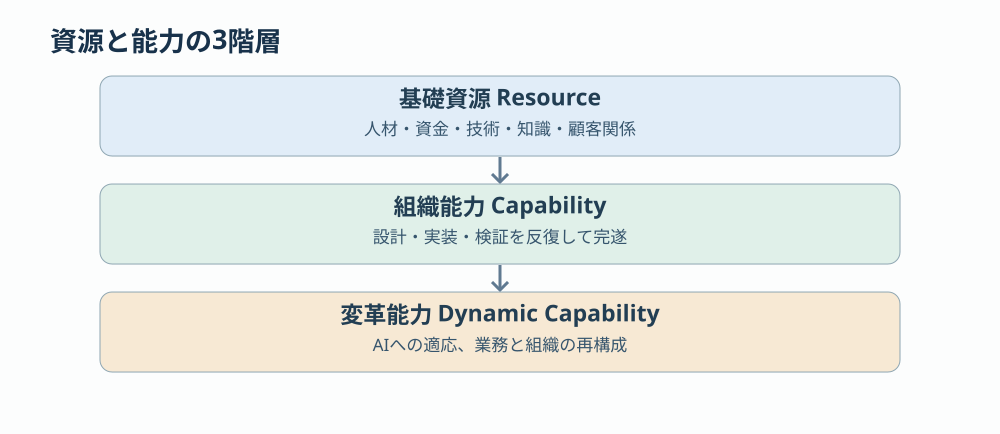

# 第2回 経営資源の分類体系 —— 種類・性質・能力・戦略価値

> [前回：経営資源とは何か](01-management-resources.md) ｜ [次回：流れと変換](03-stock-flow-transformation.md) ｜ [目次](../README.md)

## 本稿の結論

経営資源を「ヒト・モノ・カネ・情報」に分類する方法は、企業が何を保有しているかを把握するには有効である。しかし、経営戦略や組織設計、生産性向上を考えるには不十分である。理由は3つある。

1. **資源と能力が混同される。** 優秀な技術者がいることと、その技術者の能力を組織全体で活用できることは異なる。
2. **資源の性質が異なる。** 現金は使うと減るが、知識は利用しても必ずしも減らず、むしろ増加する場合がある。
3. **資源の組み合わせが価値を決める。** 同じ人材、技術、設備を持っていても、企業によって生産性や収益力が大きく異なる。

したがって、経営資源は次の4つの次元で捉えるべきである。

| 次元 | 問い | 例 |
|---|---|---|
| ① 資源の種類 | 何を持っているか | 人材・資金・技術・知識 |
| ② 資源の性質 | どう振る舞うか | 消費・蓄積・複製・劣化 |
| ③ 資源の機能 | 何を実現できるか | 生産・調整・学習・変革 |
| ④ 資源の戦略価値 | なぜ優位性を生むか | 希少性・模倣困難性 |

この4次元は独立した分類軸として組み合わせる。既存の経営理論を統合して構成した分析モデルであり、特定の研究者が提唱した単一の理論ではない。

## 1. 経営理論は経営資源をどう捉えてきたか

経営資源についての理論を時系列で整理すると、企業の捉え方が「資源の保有」から「資源の組み合わせ」、さらに「資源そのものを変革する能力」へと発展してきたことがわかる。

| 理論・研究者 | 中心となる考え方 | 資源分類への示唆 |
|---|---|---|
| エディス・ペンローズ（1959） | 企業成長の理論 | 資源自体と資源から得られるサービスは異なる |
| ディーリックス／クール（1989） | 資産ストックの蓄積 | 購入できる資源と時間をかけて蓄積する資源を区別する |
| ジェイ・バーニー（1991） | 資源ベース理論（RBV） | 資源の希少性・模倣困難性が競争優位を左右する |
| ロバート・グラント（1996） | 知識ベース理論（KBV） | 企業は専門知識を統合する仕組みである |
| デイヴィッド・ティースら（1997、2007） | ダイナミック・ケイパビリティ | 資源を再構成する能力自体が重要な経営能力となる |

### 1.1 ペンローズ：資源そのものと、資源が提供するサービスは異なる

ペンローズの『企業成長の理論』（1959年）は、資源を単なる投入物と捉える考え方を超える出発点である。同じ技術者1名であっても、何を担当させるかによって得られる成果は異なる。

| 同一の人的資源の配置 | 提供されるサービス |
|---|---|
| 案件に配置 | 設計・実装作業 |
| レビュー担当に配置 | 品質管理・技術指導 |
| 技術標準化に配置 | 複数案件に利用できる設計標準 |
| Agent Skill開発に配置 | AIによる作業自動化の仕組み |
| 技術教育に配置 | 他の技術者の能力向上 |

重要なのは技術者の人数ではなく、人的資源から取り出せる生産的サービスの種類と組み合わせである。ペンローズは、企業の経験や経営者の知識によって、保有資源から引き出せるサービスが変わると論じた。これはSIerの経営で特に重要である。人員数が一定でも、能力の配置方法と再利用の仕組みによって、組織全体の生産能力を増やせるからである。

### 1.2 バーニー：すべての資源が競争優位を生むわけではない

バーニーのRBV（Resource-Based View）は、企業の競争優位を内部資源の異質性から説明する。1991年の論文では有形・人的・組織的資源を扱い、資源が持続的競争優位を生む条件として価値、希少性、模倣困難性、代替可能性を検討した。後に広く使われるVRIOは、次の4つの観点で資源を評価する。

- **V — Value**：経済的価値を生むか
- **R — Rarity**：競合にとって希少か
- **I — Imitability**：模倣することが難しいか
- **O — Organization**：組織がその価値を活用できるか

例えば、Next.jsやPlaywrightを使用すること自体は希少性が低く、他社も模倣できる。一方、業種固有のテスト観点、過去の障害知識、案件横断の開発標準、AIによる実行・検証プロセスが統合されているなら、競合が短期間で再現することは難しくなる。**競争力の源泉は、個々のツールから、それらを結合した組織能力へ移る。**

### 1.3 グラント：企業は知識を統合するために存在する

グラントの知識ベース理論は、企業を専門的知識の統合機構として捉える。1996年の論文では、個人に分散する専門知識を組織がいかに協調・適用するかを中心問題とした。SIerには、例えば次の専門知識が分散している。

- 業務知識：決済、金融、交通、公共など
- 技術知識：フロントエンド、バックエンド、インフラなど
- 品質知識：設計レビュー、テスト設計、障害解析など
- 管理知識：見積もり、進捗管理、品質評価など

これらを個々の専門家が持っているだけでは、組織の総合的な能力にはならない。設計標準、開発プロセス、共通ライブラリ、Agent Skill、CI/CDは、専門知識を組織の生産活動に統合するための仕組みとして位置づけられる。

### 1.4 ティース：環境変化に応じて資源を再構成する能力

ダイナミック・ケイパビリティ論では、現在の資源を効率的に使うだけでなく、環境の変化に応じて資源構成や組織能力を変えることが重要になる。ティースは2007年、主に次の3つの能力を整理した。

| 能力 | 意味 | SIerの具体例 |
|---|---|---|
| Sensing | 変化・機会を感知する | AIによる開発工程の変化を検出する |
| Seizing | 機会を捉え資源を投入する | AIエージェント基盤へ投資する |
| Transforming | 組織や資源を再構成する | 人手前提のレビュー・テスト体制を再設計する |

優れた開発プロセスを保有することと、その開発プロセスを技術環境の変化に合わせて進化させることは、異なる能力である。AI導入の成果は単発のPoCではなく、変更を継続できる能力で評価する。

## 2. 経営資源の種類：7分類モデル

従来の「ヒト・モノ・カネ・情報」を出発点に、企業の競争力を説明するための資源分類を設計する。経営資源には相互依存があるため、完全に排他的な分類ではない。

| 分類 | 資源の内容 | SIerにおける具体例 |
|---|---|---|
| ① 人的資源 | 個人が保有する能力・経験・判断力 | エンジニア、アーキテクト、PM |
| ② 物的・技術資源 | 物理的・デジタル的な生産手段 | サーバー、開発基盤、ソフトウェア |
| ③ 財務資源 | 投資や運転資金に使える資本 | 現金、借入余力、予算 |
| ④ 情報・知識資源 | 記録された情報、実践知、技術知識 | 設計書、障害情報、業務ノウハウ |
| ⑤ 組織資源 | 組織内の規則、構造、制度、文化 | 開発標準、ガバナンス、評価制度 |
| ⑥ 関係資源 | 他者との継続的な関係や信用 | 顧客との信頼、協力会社との関係 |
| ⑦ 知的資産・権利 | 保護・利用・収益化可能な無形資産 | 特許、著作権、独自アルゴリズム |

この7分類は実務向けの提案である。例えばソフトウェアは②の技術資源であると同時に、④の知識を体現し、⑦の知的財産権の対象にもなる。重要なのは分類項目を増やすことではなく、**各資源に対する経営判断を明確にすること**である。

| 分類 | 経営者が問うこと | 主要な意思決定 |
|---|---|---|
| 人的資源 | 誰の能力を、どこで活用するか | 採用・育成・配置・権限移譲 |
| 物的・技術資源 | 何を保有し、何を共用するか | 標準化・内製化・購入・廃止 |
| 財務資源 | 将来のためにどこへ投資するか | 資本配分・投資評価・資金確保 |
| 情報・知識資源 | 個人の知識をどう組織で活用するか | 収集・構造化・共有・継承 |
| 組織資源 | 個人に依存せず成果を再現できるか | 組織設計・標準化・自動化 |
| 関係資源 | 誰との関係が事業価値を生むか | 顧客深耕・協業・信頼形成 |
| 知的資産・権利 | 何を競争上の固有資産として保持するか | 特許・ライセンス・権利保護 |

### 知識資源と組織資源を分ける理由

「テスト設計のノウハウ」と「テスト設計を自動化するAgent Skill」は関係が深いが、同じではない。テスト設計のノウハウは「何を、どう判断するか」という知識である。Agent Skillは、その知識を実行に結びつける手順・仕組みである。CI/CDとの統合は、その仕組みを組織の開発活動に組み込むことである。つまり、**知識は存在するだけでは価値を十分に発揮しない。実際の業務活動へ接続される必要がある。**

## 3. 資源の性質：消費される資源と、蓄積する資源

7種類の資源を、次は「どのように振る舞うか」で分類する。この分類は、経営投資の優先順位を判断するうえで重要である。

| 性質 | 定義 | 例 |
|---|---|---|
| 消耗性 | 使用によって残量が減少する | 現金、API利用枠、消耗品 |
| 非競合性 | 一人の利用が他者の利用可能性を原則として減らさない | 設計テンプレート、デジタル知識 |
| 複製可能性 | 追加の複製に必要な費用が小さい | ソフトウェア、Agent Skill |
| 蓄積性 | 投資や経験によってストックが増える | 技術力、信用、組織ノウハウ |
| 劣化性 | 時間経過や環境変化で価値が低下する | 古い技術知識、未保守のライブラリ |
| 補完性 | 他の資源と組み合わせることで価値が増す | AIモデルと業務知識、設計書とCI |
| 移転困難性 | 別の個人・組織へ移すことが難しい | 暗黙知、組織文化、顧客との信頼 |

これらは独立した性質であり、ひとつの資源に複数の性質が共存する。例えばAgent Skillは、デジタルファイルとして複製可能である一方、利用するAIモデルや業務仕様の変化によって劣化する。案件固有の知識を必要とする場合には、ファイルを複製しただけでは期待する効果が得られない。知識を文書化すれば即座に組織能力になるわけではなく、入力情報、運用手順、検証、教育を組み合わせて初めて安定して再利用できる。

### 3.1 資源には「買えるもの」と「蓄積しなければ得られないもの」がある

ディーリックスとクールは1989年、競争優位を支える戦略的資産の多くは市場で即座に購入できず、時間をかけて蓄積する必要があることを示した。

| 購入・調達できる資源 | 内部で蓄積する必要がある資源 |
|---|---|
| AIモデルのAPI利用権 | AIを適切に使いこなす組織能力 |
| CI/CDサービス | 組織に定着した継続的検証の習慣 |
| 外部の専門技術者 | チーム間の協調関係 |
| テスト自動化ツール | システム固有のテスト知識 |
| ドキュメント管理製品 | 知識が継続的に更新される文化 |

右側の資源は、資金があればすぐに手に入るとは限らない。この性質が競争優位の持続性に関係する。レビュー文化や障害知識は、購入して即日完成しない。

### 3.2 資源の蓄積はStockとFlowで表せる

量として定義できる資源なら、時間的変化は次の式で表せる。

$$
S_{t+1}=S_t+A_t-D_t
$$

- $S_t$：時点 $t$ における資源ストック
- $A_t$：期間中の獲得・生成・蓄積
- $D_t$：期間中の消費・劣化・流出

例えば組織の技術ノウハウは、新しい案件経験や教育で増加し、技術の陳腐化や退職に伴う知識の流出によって減少する。「蓄積数」だけを測ると、実際に利用できない古い資産も計上してしまう。

このモデルを使うと、SIer特有の問題が見える。案件を完遂して売上を得ても、その過程で得た知識が組織へ蓄積されなければ、長期的な経営資産は十分には増えない。逆に、案件経験を開発標準、共通コンポーネント、Agent Skillへ変換できれば、次の案件へ再投資できる資産が生まれる。

## 4. 「時間」は経営資源なのか

時間は重要だが、ヒト・モノ・カネ・情報と同列の保有資産として扱うことには注意が必要である。企業が「時間そのもの」を貯蔵することはできない。貯蔵できるのは、時間を短縮する仕組みや、将来の時間を利用できる能力である。したがって、時間は次の3つに分けて考える。

| 分類 | 意味 | 具体例 |
|---|---|---|
| 時間制約 | 活動に利用できる時間が限られる | 納期、顧客の意思決定期限 |
| 時間配分 | 人や設備の利用時間を割り当てる | 工数、設備稼働時間 |
| 時間価値 | 早く完了することで価値が変化する | 市場投入の前倒し、待ち時間の削減 |

例えばAIがコードを10倍速く生成しても、MR承認に5日かかっていれば、納期短縮の効果は限定される。時間を独立した「第8の資源」と数えるより、すべての資源と生産活動を制約する横断軸として管理する方が、経営上の判断に役立つ。

## 5. 資源と能力を分離する：最も重要な分類

ここまでの7分類は、企業が保有・利用する資源の分類である。しかし、経営能力を説明するには、資源（Resource）と能力（Capability）を明確に区別する必要がある。

- **Resource**：企業が保有・利用できるもの。例：Playwright、GitLab、テスト観点。
- **Capability**：複数の資源を組み合わせ、一定の成果を反復して生み出す能力。例：仕様からテストを設計し、実行・検証する。
- **Dynamic Capability**：既存の資源や能力を創出・変更・再構成する能力。例：モデル更新を受けてテスト方式と責任分担を変更する。

これはRBV、知識ベース理論、ダイナミック・ケイパビリティ論を接続した実務モデルである。SIerの具体例を示す。

| 基礎資源 | 組織能力 | 変革能力 |
|---|---|---|
| Playwright、テスト設計知識 | 自動テストを安定実行する | 新技術に応じてテスト戦略を変更する |
| GitLab、CI設定、技術者 | 継続的インテグレーション | 開発プロセスを継続改善する |
| Figma、UI Kit、コンポーネント | 一貫したUIを効率よく開発する | デザインシステムを進化させる |
| LLM、Agent Skill、設計書 | AIによる設計・実装・検証 | AIと人間の役割分担を再構成する |

この区別には重要な経営上の意味がある。Agent Skillを100個保有していても、実際の案件で使用されず、成果も測定されていなければ、それだけで十分な組織能力があるとはいえない。逆に10個のSkillでも、多数の案件で品質と生産性の向上を反復して実現していれば、組織能力として価値が高い。**資源の保有量と組織能力の大きさは比例しない。**

## 6. AI時代のSIerで、どの資源に投資すべきか

具体例として、AIを用いたテスト設計・実行の標準化を考える。以下は実測値ではなく、投資評価方法を説明するための仮想モデルである。

| 項目 | 値 |
|---|---:|
| 初期開発工数 | 200時間 |
| 年間適用案件数 | 20件 |
| 1案件あたり削減工数 | 30時間 |
| 年間保守工数 | 100時間 |
| 年間総削減工数 | 600時間 |
| **初年度純削減工数** | **300時間** |

純削減工数 ＝ 総削減工数 − 初期開発200時間 − 年間保守工数。案件間の差、品質変化、API利用料、機会費用は含まない。

この投資は次の資源変換として理解できる。

$$
\text{人的資源}+\text{財務資源}\ \rightarrow\ \text{技術資源}+\text{組織能力}
$$

重要なのは、投資で生み出した技術資源が繰り返し利用できることである。人が案件ごとに個別作業をする場合、活動の成果は案件に帰属しやすい。一方、再利用可能なSkillやCIライブラリを作れば、その成果を複数案件へ展開できる。ただし、再利用には移植、保守、教育、実行費用が必要である。**複製可能であることと、追加費用なしで展開できることは同義ではない。**

## 7. 推奨する分類体系：8軸の多軸モデル

単一の樹形図ではなく、次の多軸分類モデルを推奨する。

| 分類軸 | 主な分類 | 答える経営課題 |
|---|---|---|
| ① 種類 | 人・技術・財務・知識・組織・関係・権利 | 何を保有・利用するか |
| ② 階層 | 基礎資源・組織能力・変革能力 | 何ができるか |
| ③ 性質 | 消耗・蓄積・複製・劣化・補完 | どう変化するか |
| ④ 調達 | 購入・内部開発・外部連携 | どう獲得するか |
| ⑤ 所有・支配 | 所有・契約利用・共同利用 | どこまで制御できるか |
| ⑥ 流動 | 投入・変換・蓄積・流出 | どこに移動するか |
| ⑦ 戦略価値 | 価値・希少性・模倣困難性・組織活用 | なぜ競争力を生むか |
| ⑧ 時間 | 調達時間・蓄積時間・陳腐化速度 | いつ価値を発揮するか |

### 具体例：Agent Skillを8軸で分類する

| 分類軸 | 分類結果 |
|---|---|
| 種類 | 技術資源・知識資源 |
| 階層 | 基礎資源。業務に統合されると組織能力の構成要素 |
| 性質 | 複製可能・非競合的利用が可能・陳腐化する |
| 調達 | 内部開発・外部取得・共同改善 |
| 所有・支配 | 自社管理可能。ただし外部モデル・APIに依存する |
| 流動 | 知識抽出 → 実装 → 評価 → 配布 → 改善 → 蓄積 |
| 戦略価値 | 独自の業務知識・評価基盤と統合されるほど模倣困難性が高まる |
| 時間 | 短時間で複製可能。適用・検証・保守には継続的に時間がかかる |

この表現なら、経営者は「Skillが何個あるか」という資源数だけでなく、「何ができるか」「どの程度活用されているか」「何が劣化しているか」「次にどこへ投資すべきか」を判断できる。

## 8. 経営資源には3つの異なる価値がある

最後に、投資評価の観点から次の3つを区別したい。

- **① 利用価値（Use Value）**：その資源を使うことで、現在の活動がどれだけ改善されるか。例：AIによってテスト設計工数が削減される。
- **② 蓄積価値（Accumulation Value）**：その活動によって、将来利用できる資源がどれだけ増えるか。例：AIテスト実行から得た失敗パターンを組織知として蓄積する。
- **③ 変革価値（Transformation Value）**：その資源によって、従来は実現できなかった組織能力や事業構造が生まれるか。例：テスト設計・実行・結果検証を自律化し、品質保証の運営方式そのものを変える。

この3分類は、既存の経営理論を基にした投資評価のための提案であり、会計上の資産価値や確立された財務指標とは区別する。同じ100万円の投資でも、目先の工数削減に使うか、組織知の蓄積に使うか、新しい事業能力の構築に使うかで、経営上の意味は異なる。

**経営資源論の中心問題は、何をどれだけ持つかではない。限られた資源を使って、将来の資源と能力をどれだけ生み出せるかである。** ここから先は、資源を静的に分類する段階から、資源がどのように相互作用し、変換・蓄積・増幅・劣化するかという動的なモデルへ進む。それによってRBV、知識ベース理論、ダイナミック・ケイパビリティを、システム思考や制約理論と接続できる。

**本稿の問い**：当社の資源台帳は「何を持つか」だけでなく、「どこで使われ、何を生み、いつ陳腐化するか」まで表現できるか。

[第3回：資源の流れと変換](03-stock-flow-transformation.md)

### 参考文献

- Edith Penrose, *The Theory of the Growth of the Firm*, 1959.
- Ingemar Dierickx and Karel Cool, “Asset Stock Accumulation and Sustainability of Competitive Advantage,” *Management Science*, 1989. https://doi.org/10.1287/mnsc.35.12.1504
- Jay B. Barney, “Firm Resources and Sustained Competitive Advantage,” *Journal of Management*, 1991. https://doi.org/10.1177/014920639101700108
- Robert M. Grant, “Toward a Knowledge-Based Theory of the Firm,” *Strategic Management Journal*, 1996. https://doi.org/10.1002/smj.4250171110
- David J. Teece, Gary Pisano, Amy Shuen, “Dynamic Capabilities and Strategic Management,” 1997. https://doi.org/10.1002/(SICI)1097-0266(199708)18:7%3C509::AID-SMJ882%3E3.0.CO;2-Z
- David J. Teece, “Explicating Dynamic Capabilities,” *Strategic Management Journal*, 2007. https://doi.org/10.1002/smj.640
