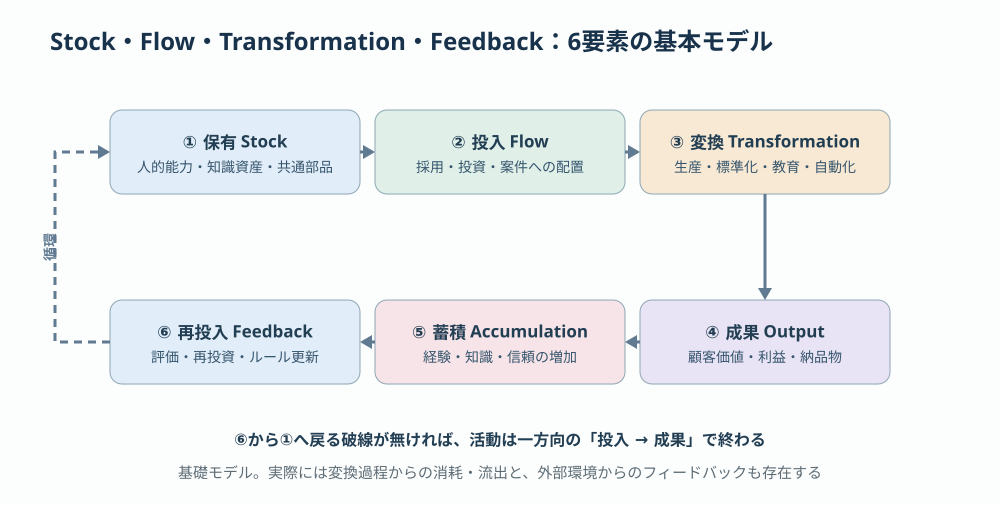
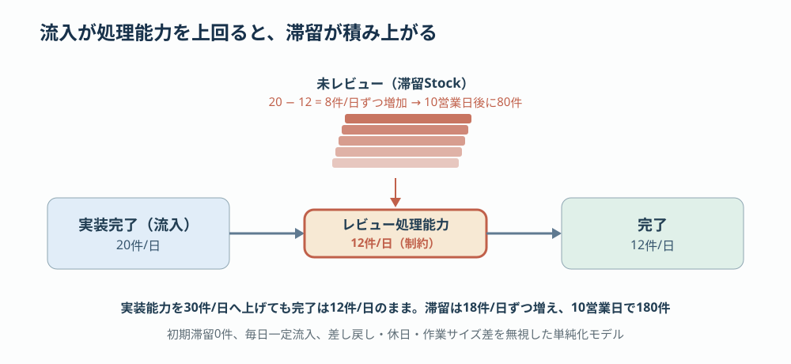
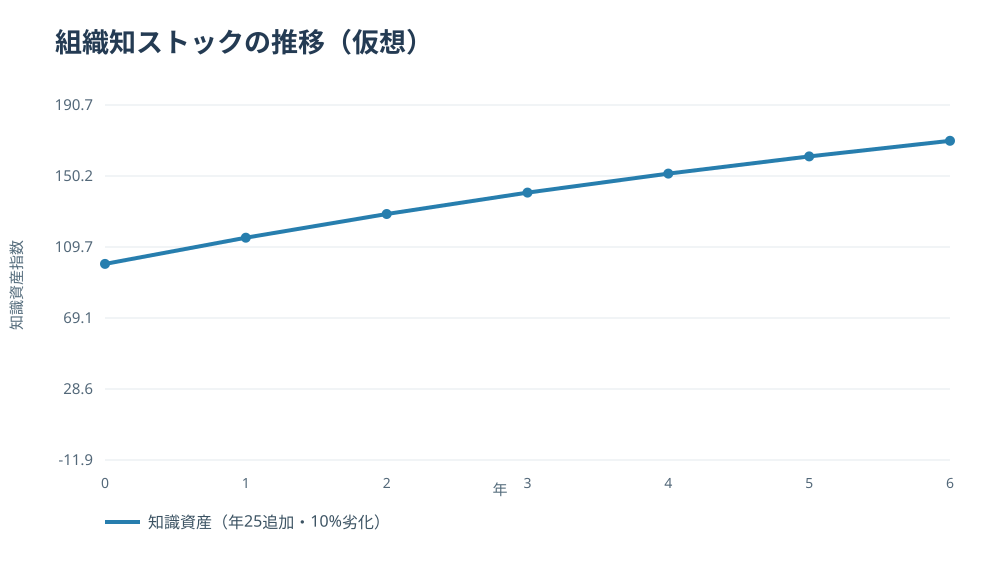
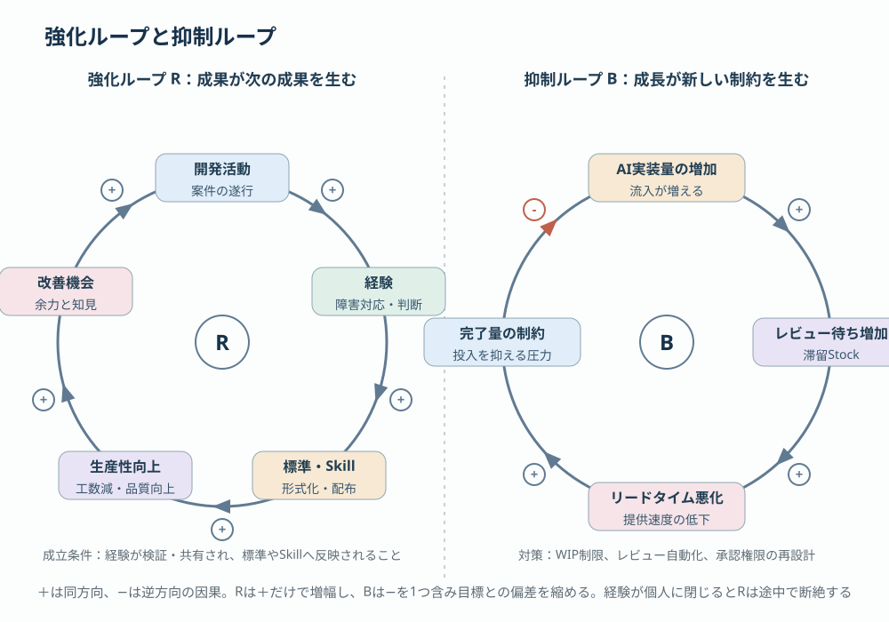
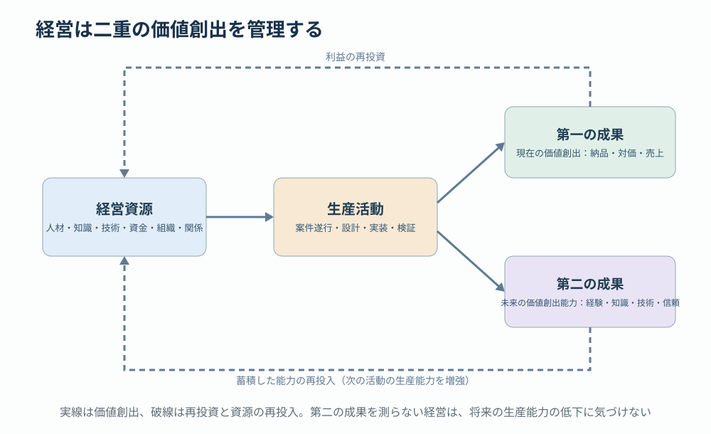

# 第3回 資源の流れと変換 —— Stock・Flow・Feedbackで企業を捉える

> [前回：分類体系](02-resource-taxonomy.md) ｜ [次回：配分と制約](04-allocation-constraints.md) ｜ [目次](../README.md)

## 本稿の結論

前回は、経営資源を「種類・性質・機能・戦略価値」で分類した。次の論点は、これらの資源が企業内部でどのように移動し、変換され、蓄積されるかである。**企業は資源の集合ではなく、資源を変換・循環・増幅するシステムである。**

基本モデルは、資源の保有（Stock）、投入（Flow）、変換（Transformation）、成果、蓄積、再投入（Feedback）の6要素からなる。

このモデルの重要な特徴は、企業の活動を一方向の「投入→成果」で終わらせないことである。活動の結果を次の生産能力に変換できる企業は、同じ資源量からより大きな将来価値を生み出せる。ただし、循環するだけで資源が増えるわけではない。増幅には、外部からの資源投入、知識の獲得、変換効率の改善が必要である。実際には、変換過程からの消耗・流出と、外部環境からのフィードバックも存在する。

## 1. 5つの理論の分担

資源の流れと変換を考えるうえで、次の5つの理論が補完的な関係にある。

| 理論 | 主な研究者 | 中心概念 | 説明する現象 |
|---|---|---|---|
| システムダイナミクス | ジェイ・フォレスター | Stock・Flow・Feedback | 資源量が時間とともにどう変化するか |
| 企業成長の理論 | エディス・ペンローズ | 資源の生産的サービス | 同じ資源から異なる価値が生まれる理由 |
| 制約理論（TOC） | エリヤフ・ゴールドラット | 制約・スループット | なぜ一部の能力向上が全体成果に結びつかないか |
| 知識ベース理論 | ロバート・グラント | 専門知識の統合 | 個人の知識が組織能力になる仕組み |
| ダイナミック・ケイパビリティ | デイヴィッド・ティース | 資源・能力の再構成 | 企業が変化に適応し成長する仕組み |

フォレスターは企業を時間的に変化するフィードバックシステムとして分析した。ペンローズは資源の組み合わせと経営経験が企業成長を規定することを論じた。TOCは全体成果を制約する箇所に着目する。これらを統合すると、次の問いが立てられる。

> 企業が成長しないのは、資源が足りないからなのか。それとも、資源が滞留し、変換されず、蓄積に結びついていないからなのか。

この区別が経営判断を大きく変える。

## 2. StockとFlow：経営資源の蓄積を説明する

### 2.1 Stockは状態、Flowは変化の速度

Stockは、ある時点で存在する蓄積量である。Flowは、一定期間にStockを増減させる速度である。

| 対象 | Stock | 流入Flow | 流出Flow |
|---|---|---|---|
| 財務 | 現預金残高 | 入金・借入 | 支払・返済 |
| 人材 | 在籍技術者数 | 採用・異動受入 | 退職・異動 |
| 知識 | 利用可能な組織知 | 新規獲得・文書化 | 陳腐化・喪失 |
| 技術資産 | 利用可能な共通部品 | 開発・調達 | 廃止・劣化 |
| 顧客関係 | 継続的取引関係 | 新規獲得・関係構築 | 取引終了・関係喪失 |
| 仕事 | 未完了タスク数 | 新規着手・流入 | 完了・中止 |

Stockの基本式は以下である。

$$
S(t)=S(0)+\int_0^t\bigl[I(\tau)-O(\tau)\bigr]\,d\tau
$$

$I$ は流入速度、$O$ は流出速度である。このモデルは資金や人数のような明確な量だけでなく、定義と評価尺度を与えれば、知識や技術資産にも応用できる。

### 2.2 ストックが多いことは必ずしもよいことではない

未完了MRはStockである。新しいMRの作成が流入、マージ・クローズが流出になる。MR作成速度がマージ速度を上回れば未完了MRの数は増加するが、これは開発成果が蓄積しているのではなく、完成に至る前の仕事が滞留している状態である。同じStockでも、組織知や現預金の蓄積と、未完了作業の蓄積は経営上の意味が異なる。

- **生産的Stock**：将来の価値創出能力を高める。例：再利用できる知識資産、現預金。
- **滞留Stock**：価値創出前の資源を拘束する。例：未完了MR、レビュー待ち。
- **リスクStock**：将来の費用や損失の原因となる。例：技術負債、未保守の依存関係。

この3分類は実務的な管理上の分類である。

## 3. Flowの重要性：経営は資源の量よりも流れる速度に依存する

仮想のソフトウェア開発チームを考える。開発者の実装能力は1日20件分、レビュー担当者の処理能力は1日12件分とする。

| 項目 | 値 |
|---|---:|
| 実装完了・レビュー流入 | 20件/日 |
| レビュー処理能力 | 12件/日 |
| 経過営業日 | 10日 |
| 期間内のレビュー完了上限 | 120件 |
| **期間末の未レビュー件数** | **80件** |

初期滞留0件、毎日一定流入、差し戻し・休日・作業サイズの違いを無視した単純化モデルである（滞留の推移図は第4回に掲載する）。

[動く版を見る（SVGアニメーション）](../assets/animated/03-flow-bottleneck.svg) ／ [GIF](../assets/gif/03-flow-bottleneck.gif)

この例で重要なのは、実装能力を20件から30件へ引き上げても、レビュー能力が12件のままであれば日次完了数は増えないという点である。むしろ未完了作業が増加する。これはゴールドラットの制約理論の中心的な考え方と一致する。局所的な効率改善ではなく、システム全体のスループットを決定する制約に改善を集中すべきである。ただし、この例の「件/日」は業務フロー上の処理能力であり、TOCのスループット会計における貨幣単位のスループットとは区別する。

## 4. 資源の変換：企業の活動をどう分類するか

StockとFlowだけでは、経営活動のすべてを説明できない。例えば100時間の作業が、ソースコード、技術知識、顧客信頼のどれに変換されたかは、StockとFlowだけではわからない。そこで、資源間の変換を独立したモデルとして扱う。

### 4.1 7種類の資源変換

| 変換類型 | 定義 | SIerにおける具体例 |
|---|---|---|
| ① 消費型 | 資源を消費し成果を生む | 工数・クラウド費用 → 納品物 |
| ② 蓄積型 | 活動を通じて資源を増やす | 開発経験 → 技術知識 |
| ③ 固定化型 | 暗黙的な能力を反復利用可能な形にする | 熟練者のノウハウ → Agent Skill |
| ④ 複製型 | 既存資源を多地点へ展開する | 共通部品 → 複数案件で利用 |
| ⑤ 統合型 | 異なる資源を組み合わせる | 設計標準＋CI＋AI → 自律検証 |
| ⑥ 再配置型 | 資源の用途・配置を変更する | 実装担当者 → 品質戦略担当者 |
| ⑦ 再生型 | 劣化した資源の価値を回復する | 技術負債の解消、Skillの更新 |

これは経営活動を分析するための独自の類型化であり、既存理論で確立された分類ではない。資源を変換するとき、投入資源がすべてなくなるわけではない。知識をSkillに固定化しても元の技術者から知識が消えるわけではなく、むしろ説明・実装・検証の過程で知識が深まることもある。

### 4.2 変換効率をどう測定するか

単純な生産活動であれば、変換効率は次のように定義できる。

$$
\eta=\frac{\text{有効な成果量}}{\text{投入資源量}}
$$

ただし、人的資源、知識資源、関係資源を同じ単位で合算することはできない。実務では、変換ごとに入出力の単位をそろえる。

| 変換 | 測定指標 |
|---|---|
| 工数 → 完成機能 | 品質基準を満たす完成機能数／人時 |
| テスト設計 → 欠陥検出 | 対象欠陥の検出率、見逃し率、作業工数 |
| 案件経験 → 組織知 | 検証済み知識の再利用件数 |
| ノウハウ → Skill | 自動化成功率、例外対応率 |
| Skill → 案件展開 | 適用案件数、適用準備工数、純削減工数 |
| 研究開発 → 事業能力 | 新機能提供までの期間、事業成果 |

評価は単一指標ではなく、品質・費用・速度の組み合わせで行う。

## 5. 数値シミュレーション：知識の蓄積と陳腐化

蓄積型の変換を最も単純に表す。初期知識資産指数100、毎年25単位を追加、毎年10%劣化するとする。

$$
K_{t+1}=0.9K_t+25,\quad K_0=100
$$

このモデルでは、知識の追加だけでなく陳腐化が存在する。追加を停止すると、使える資産の指数は低下する。実際の経営では「知識資産指数」を定義して測定する必要があり、図は実測値ではない。第5回では、この式を案件経験と改善投資の2項に分けて扱う。

## 6. 知識の変換：野中郁次郎のSECIモデルとの接続

知識資源は、経営資源の中でも特徴的である。資金や設備とは異なり、知識は共有・実践・統合によって新しい知識を生み出せる。野中郁次郎の組織的知識創造理論は、暗黙知と形式知の相互作用を通じて知識が創造されることを説明する。1994年の論文では、4種類の知識変換が提示されている。

| 様式 | 方向 | SIerの例 |
|---|---|---|
| 共同化 Socialization | 暗黙知 → 暗黙知 | ペア作業、熟練者との共同レビュー |
| 表出化 Externalization | 暗黙知 → 形式知 | レビュー観点をルールとして文書化 |
| 連結化 Combination | 形式知 → 形式知 | 設計書・テスト標準・Skillを統合 |
| 内面化 Internalization | 形式知 → 暗黙知 | Skillを利用しながら判断方法を習得 |

Agent Skillは、知識の表出化と連結化を支援する実装手段になり得る。しかし、Skillにルールを記述しただけで、熟練者の暗黙知すべてを再現できるわけではない。経験に基づく状況判断、例外への対応、判断の責任は別途設計する必要がある。文書をAIに読み込ませただけでは全知識を再現できず、例外条件、判断基準、実行環境、評価データを整える必要がある。

この観点から、AIエージェントの価値は単なる作業代行だけではない。**人間の活動から知識を抽出し、検証可能な形式で固定化し、その知識を再び人間とAIの実行へ還流させること**にある。

## 7. Feedback：資源の流れが自己増幅する仕組み

フォレスターのシステムダイナミクスで重要なのは、変化が一方向ではなく、フィードバックループによって生まれるという考え方である。経営におけるループは、大きく2種類に分けられる。

[動く版を見る（SVGアニメーション）](../assets/animated/03-feedback-loops.svg) ／ [GIF](../assets/gif/03-feedback-loops.gif)

### 7.1 強化ループ：成果が次の成果を生む

> 開発活動 → 経験 → 標準・Skill → 生産性向上 → 追加の改善機会 → 開発活動

このループが成立する条件は、開発活動から得られた経験が適切に検証・共有され、標準やSkillへ反映されることである。経験が個人に閉じている場合や、Skillが利用されない場合、循環は途中で断絶する。

### 7.2 抑制ループ：成長が新しい制約を生む

> AIによる実装量増加 → レビュー待ち増加 → リードタイム悪化 → 完了量の制約

これに対してWIP制限、レビュー自動化、承認権限の再設計を実施すると滞留が抑制される。これは目標状態との偏差を縮小する「バランシング・ループ」の例である。さらに、開発能力と検証能力の双方が向上すると、今度は要求決定、受け入れ、リリース承認など別の箇所が制約になり得る。**制約は固定されない。組織の能力構成が変われば移動する。**

## 8. 企業には複数の資源循環が同時に存在する

SIerの経営を考える場合、最低でも次の4つの循環を分けて見るとよい。

| 循環 | 主要な流れ | 主なストック | 代表的な制約 |
|---|---|---|---|
| 財務循環 | 投資 → 事業活動 → 売上 → 回収 → 再投資 | 現金・資本 | 収益性・資金回収 |
| 生産循環 | 要求 → 設計 → 実装 → 検証 → 納品 | 未完了作業・完成資産 | 処理能力・承認 |
| 知識循環 | 経験 → 分析 → 形式化 → 再利用 → 改善 | 技術知識・標準 | 知識抽出・保守 |
| 能力循環 | 学習 → 実践 → 熟練 → 指導 → 能力拡張 | 人的能力・組織能力 | 教育・経験機会 |

これらの循環は相互に影響する。短期利益を最大化するために全技術者を案件作業へ配置すると、生産循環は一時的に増えるかもしれない。しかし、教育、標準化、Skillの保守に投資する時間が減れば、知識循環と能力循環が弱くなり、将来の生産性が低下する可能性がある。**ひとつの循環の最適化が、別の循環を毀損することがある。** これは経営資源を個別管理するだけでは見落としやすい問題である。

## 9. SIerの経営モデル：資源消費型と資源蓄積型の違い

ここまでの理論を、2つの仮想的なSIerに適用する。

| | モデルA：案件完結型 | モデルB：資産蓄積型 |
|---|---|---|
| 基本姿勢 | 案件を遂行して収益を得る（消費中心） | 案件を遂行しながら次の生産能力を作る（蓄積中心） |
| 活動 | 人材・時間・技術を投入し、案件ごとに納品物を生産する。経験は個人や案件内に残る | 案件経験を共通部品、設計標準、Agent Skill、テスト資産へ変換する。再利用から得た知見をさらに改善へ投入する |
| 主な管理指標 | 売上、粗利益、稼働率、案件別工数 | 売上、粗利益、再利用率、純削減工数、資産保守費、組織能力 |

数値で比較する。初年度に共通資産の開発へ1,000時間を投じ、その後は1案件あたり40時間を削減でき、年間保守に200時間かかるとする。毎年20案件で利用し、削減効果は一定と仮定すると、累積純削減工数は1年目−400時間、2年目200時間、5年目2,000時間となる（計算式と図は第5回§6.4に掲載する）。初年度は投資が先行し、2年目に累積がプラスに転じる。実在企業の数値ではない。

ただし、開発投資の判断には、工数だけでなく品質影響、外部費用、需要、保守負担、技術の陳腐化、実際に削減した時間をどう活用するかを評価する必要がある。また、重要なのは「全案件を標準化すること」ではない。標準化によって失われる案件固有の適応力も考慮し、共通化可能な部分を選別することである。

## 10. 資源変換を管理するための経営ダッシュボード

実務への適用では、資源の量だけでなく、次の5領域を管理対象とする。

| 管理領域 | 指標例 | 判断したいこと |
|---|---|---|
| 資源ストック | 再利用可能な資産数、技術負債、未完了MR | 何が蓄積しているか |
| 資源フロー | 案件投入率、MR完了速度、資金回収速度 | どこで流れが滞るか |
| 変換効率 | 品質基準を満たす成果／投入工数 | どこで効率が悪いか |
| 資産再生産 | 共通資産への還元率、実利用率、改善頻度 | 将来の能力が増えているか |
| 制約・適応 | ボトルネック、リードタイム、能力変更所要時間 | どこを変えるべきか |

GitLabを利用する開発組織では、次を観測点として実測しやすい。

- Issue：要求と仕事の流入、完了、滞留。
- MR：レビュー待ち、滞留、作成からマージまでの統合速度。
- CI/CD：検証成功率、実行時間、失敗原因、再実行。
- 共通リポジトリ：共通資産の変更と再利用状況、保守量。
- Agent Skill実行記録：適用実績、成功率、例外発生、保守負担、純削減工数。

これらはそれぞれ異なる資源フローの観測点になる。単純に集計値を並べるのではなく、Issueから納品までの仕事の流れと、案件経験から共通資産への知識の流れを関連づけることが重要である。計測の前に、開始・完了・レビュー可能状態などのイベント定義を統一し、件数を比較する際には作業サイズと難易度の違いに注意する。

## 11. 最終モデル：経営は二重の価値創出を管理する

以上を踏まえると、経営活動は2つの出力を持つシステムとして整理できる。

- **第一の成果：現在の価値創出。** 顧客にサービスや製品を提供し、対価を獲得する。
- **第二の成果：未来の価値創出能力の形成。** 活動から得た経験、知識、技術、信頼を蓄積し、次の活動の生産能力を増強する。

[動く版を見る（SVGアニメーション）](../assets/animated/03-dual-output.svg) ／ [GIF](../assets/gif/03-dual-output.gif)

この二重性こそ、資源の流れと変換を経営の中心に置く理由である。ペンローズの企業成長論は資源の利用と成長の関係を説明し、フォレスターのシステムダイナミクスは時間的な蓄積・循環を説明する。ティースのダイナミック・ケイパビリティ論は、環境変化に応じた資源の再構成を説明する。これらを統合すると、次の経営原則を導ける。

> 優れた経営とは、現在の経営資源から最大の成果を得ることだけではない。現在の生産活動を通じて、将来の生産能力を継続的に形成し、その能力を環境変化に応じて再構成できることである。

**本稿の問い**：案件経験から共通資産への流れを、実際に追跡・評価できるか。

次回は、この流れのどこに制約があり、限られた資源をどこへ配分すべきかを扱う。

[第4回：資源配分と制約](04-allocation-constraints.md)

### 参考文献

- Jay W. Forrester, *Industrial Dynamics*, 1961.
- Edith Penrose, *The Theory of the Growth of the Firm*, 1959.
- Eliyahu M. Goldratt and Jeff Cox, *The Goal*, 1984.
- Ikujiro Nonaka, “A Dynamic Theory of Organizational Knowledge Creation,” *Organization Science*, 1994. https://doi.org/10.1287/orsc.5.1.14
- Robert M. Grant, “Toward a Knowledge-Based Theory of the Firm,” 1996. https://doi.org/10.1002/smj.4250171110
- David J. Teece, “Explicating Dynamic Capabilities,” 2007. https://doi.org/10.1002/smj.640
