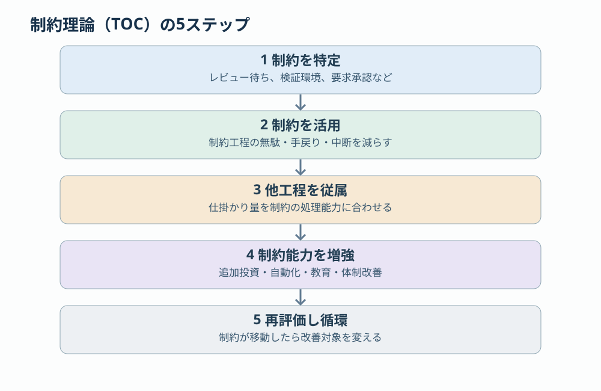
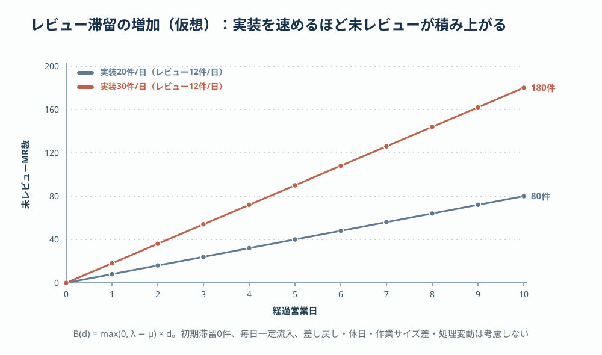
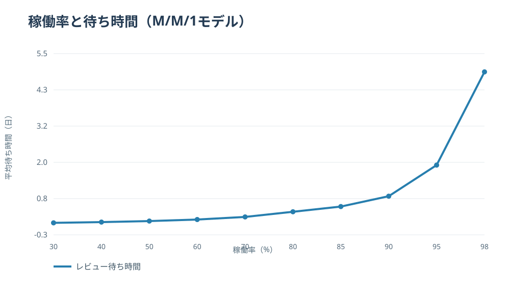

# 第4回 資源配分と制約 —— 全体最適を阻むボトルネック

> [前回：流れと変換](03-stock-flow-transformation.md) ｜ [次回：AI時代のSIer経営](05-ai-sier-model.md) ｜ [目次](../README.md)

## 本稿の結論

前回は、企業を資源の蓄積・流入・変換・循環からなるシステムとして整理した。本稿で考えるのは、限られた経営資源を**どこへ、どれだけ、どの順序で**配分すれば、企業全体の価値創出能力が最大化するかである。

ここで2つの概念を区別する。

- **資源配分（Resource Allocation）**：限られた資金・人材・時間・技術を、競合する用途へ割り当てる意思決定。「何を選ぶか」を扱う。
- **制約（Constraint）**：組織が目標を達成する際に、成果の上限や実現可能な選択肢を制限している条件。制約管理は「何を変えるべきか」を扱う。

両者を統合すると、経営は次の問題になる。

$$
\max_{\mathbf{x}} V(\mathbf{x})\quad\text{subject to }A\mathbf{x}\le\mathbf{b}
$$

- $\mathbf{x}$：各活動・事業への資源配分量
- $V(\mathbf{x})$：企業が獲得する価値
- $A$：活動ごとに必要な資源の量
- $\mathbf{b}$：利用可能な経営資源の上限

重要なのは、**すべての資源を最大限稼働させることと、企業全体の価値を最大化することは一致しない**という点である。AIによって実装工数が大きく削減されても、レビューやテスト承認が滞留しているなら、実装能力への追加投資は納品速度の改善につながらない。この状況では、実装能力の拡大よりも、レビュー能力の改善や作業投入量の制御が優先される。

## 1. 5つの理論は対立しない —— 扱う問題の階層が違う

| 理論 | 中心概念 | 資源配分への示唆 | SIerへの適用 |
|---|---|---|---|
| 経済学・機会費用 | 選択によって断念する次善の価値 | 何に使わないかを含めて判断する | 案件工数と共通投資の比較 |
| 最適化理論 | 制約条件付きの価値最大化 | 資源ごとの限界価値を比較する | プロジェクトポートフォリオ |
| 制約理論（TOC） | ボトルネックと全体スループット | 制約の改善に資源を集中する | レビュー・検証工程への注力 |
| 待ち行列理論 | 稼働率、変動、待ち時間 | 余力とWIP制限を設計する | MR滞留・待ち時間 |
| 組織学習理論 | 探索と深化の資源配分 | 現在の収益と将来の成長を両立する | 案件、標準化、AI探索 |

これらは対立する理論ではなく、解決する問題の階層が異なる。経済学は選択の価値、最適化理論は配分の計算、TOCは改善対象の特定、待ち行列理論は仕事の流動性、組織学習理論は時間軸をまたぐ能力形成を扱う。以下では「いま何が全体を制約しているか」から始める。

## 2. TOC：制約が全体の能力を決める

エリヤフ・ゴールドラットが提唱した制約理論（TOC）は、組織全体の成果を制約する要因を特定し、そこへ改善を集中する経営理論である。TOCでは設備能力だけでなく、組織の規則、管理上の意思決定、人の能力も制約として扱う。

### 2.1 開発工程のボトルネック

| 工程 | 処理能力（件/日） |
|---|---:|
| 設計 | 16 |
| 実装 | 24 |
| レビュー | 10 |
| 検証 | 14 |
| リリース | 18 |
| **工程全体の理論上限** | **10** |

各工程が必須で、同じ作業単位を処理し、手戻りや処理時間の変動を無視した単純化モデルである。実装能力が24件/日でも、レビュー能力が10件/日なら、工程全体の完成能力は10件/日に制約される。この状況で実装能力をさらに高めても、理論上の完成能力は変わらない。一方、レビュー能力を10件から16件へ高めると、次は検証能力14件/日が制約になる。**制約は解消すると移動する。改善の優先順位も移動する。**

なお、この「件数」の処理上限は、TOCのスループット会計における貨幣単位のスループットとは区別する。

### 2.2 5つの集中ステップ

| ステップ | 内容 | GitLabを使う開発組織での例 |
|---|---|---|
| 1 | 制約を特定する | MR作成からマージまでの時間を分析し、レビュー待ちが主要因か確認する |
| 2 | 制約を最大限活用する | レビュー観点の標準化、事前CI検証、MRの適切な分割で、レビュアーの時間を有効に使う |
| 3 | 他の活動を制約に従属させる | 実装の開始量を調整し、レビュー待ちを過度に増やさない |
| 4 | 制約の能力を高める | レビュアーの育成・追加、AIによる一次レビューや自動検証の導入 |
| 5 | 制約を再評価する | 検証、リリース承認、要求決定など、次の制約を特定する |

特に重要なのは第3ステップである。非制約工程に「余力があるから、さらに作業を開始する」と指示すると、システム内の滞留が増える。**制約の処理能力に合わせて新しい仕事を投入する**という判断は、個人の稼働率最大化とは異なる判断であり、非制約工程の稼働率を意図的に下げることを含む。

## 3. 生産性向上の逆説：実装が速くなるほど完成が遅れる

AI駆動開発では、第3ステップを怠ったときの帰結が端的に現れる。

> AIによる実装生産性の向上 → MR・テスト対象の流入増加 → レビュー・検証工程の滞留 → 完成までのリードタイム悪化

この連鎖では、開発者個人の生産性は改善しているが、企業としての価値提供速度は改善していない可能性がある。さらにレビュー待ちが長期化すると、次の悪影響も生じる。

- コンフリクトの増加と再調整工数の発生
- フィードバックの遅れによる手戻りの拡大
- 大量の未完了作業による進捗管理負荷の増加
- 特定レビュアーへの依存集中
- 人による確認が形式化することによる品質リスク

これは単なるツールの問題ではなく、経営資源の相互依存関係の問題である。AIによる生産能力の増大は、自動的に全体成果を増大させるのではない。増えた生産能力に合わせて、資源の配分と仕事の流れを再設計する必要がある。

滞留を最も単純に数値化すると次のようになる。新しいMRが20件/日、レビュー完了が12件/日、初期滞留が0なら、10営業日後の未レビュー件数は80件。AI導入で流入だけを30件/日へ増やせば180件に増える。

$$
B_d=\max(0,\lambda-\mu)\,d
$$

- $\lambda$：流入件数/日
- $\mu$：処理能力件数/日
- $d$：営業日数

[計算データCSV](../simulation/04-review-backlog.csv)。差し戻し・休日・作業サイズ差・処理変動は考慮しない単純モデルである。

## 4. 機会費用：配分とは「何に使わないか」を決めること

経営資源には複数の用途がある。したがって、ある活動へ資源を配分することは、他の活動へ配分する機会を失うことでもある。これを**機会費用（Opportunity Cost）**という。

### 4.1 技術者の160時間をどこに配分するか

専門性の高いエンジニアが1か月に160時間稼働できるとする。その時間には、例えば次の用途がある。

| 活動 | 現在の成果 | 将来の成果 |
|---|---|---|
| A：案件開発 | 売上・案件進捗 | 案件経験 |
| B：コードレビュー | 品質向上・手戻り抑制 | レビュー知識の蓄積 |
| C：共通基盤開発 | 当期の費用発生 | 複数案件の生産性向上 |
| D：技術教育 | 教育期間中の生産能力減少 | 他者の技術力向上 |
| E：AI活用の研究 | 実証費用の発生 | 新たな生産能力の獲得 |

160時間すべてを案件作業へ配分すれば、短期の案件進捗を最大化できる場合がある。しかし、共通基盤開発に40時間を投入することで翌月以降の複数案件で継続的な工数削減が生じるなら、その投資の価値が直接案件作業の価値を上回る可能性がある。この判断には、**現在の収益と将来の生産能力を共通の評価基準に換算する**必要がある。

### 4.2 限界価値による配分

資源を1単位追加したとき、価値がどれだけ増加するかを限界価値という。

$$
MV_i=\frac{\partial V}{\partial x_i}
$$

$x_i$ は活動 $i$ に配分する資源量である。資源投入の追加費用も考慮する場合は、純便益の限界増分で比較する。同一の資源を複数用途へ自由に配分でき、内部解が成立する条件では、各用途の限界純便益が等しくなるまで配分することが合理的である。

ただし、現実の経営資源には分割不能性がある。エンジニアの専門性、契約条件、納期、チーム構造によって、時間を単純に細分化できるわけではない。そのため、**数理的に最適な配分と、組織として実行可能な配分は区別すべき**である。

## 5. シャドープライス：どの資源が最も不足しているのか

最適化理論の**シャドープライス（Shadow Price）**は、ある制約資源を1単位増やしたときに最適な目的関数値がどれだけ改善するかを表す。同じ技術者1時間でも、十分な余力がある実装工程に投入する場合と、レビューが滞留している工程に投入する場合では、組織全体への価値が異なる。

### 5.1 2種類の案件への配分問題

| | 案件A | 案件B |
|---|---:|---:|
| 1単位の貢献利益 | 80万円 | 60万円 |
| 実装工数 | 40h | 20h |
| レビュー工数 | 10h | 20h |

利用可能な資源は実装160時間、レビュー60時間とし、需要上限はないものとする。どちらの案件を何単位進めれば貢献利益が最大になるか。

$$
\max 80x_A+60x_B
$$
$$
40x_A+20x_B\le160,\quad 10x_A+20x_B\le60,\quad x_A,x_B\ge0
$$

連続最適化問題として解くと、$x_A=10/3$、$x_B=4/3$、貢献利益は約346.7万円となる。両資源の制約が有効（使い切り）であり、シャドープライスは**実装約1.67万円/h、レビュー約1.33万円/h**である。これは最適配分の近傍で資源上限だけを微小に緩和した場合の目的関数増分であり、人件費を差し引いた利益ではなく、定義した貢献利益に対する限界価値である。

ここで興味深いのは、レビューが不足しているように見えても、最適配分上では実装1時間の方が高い限界価値を持つことである。**不足しているという印象と、追加投資の経済価値は必ずしも一致しない。** 資源の価値は、それ自体の希少さではなく、案件構成・需要・他資源との組み合わせで決まる。なお、整数単位でしか受注できない案件では整数計画問題として解く必要があり、結果は変わる。

### 5.2 シャドープライスを経営判断に使う

同じ考え方で、例えば次の選択肢を比較できる。

- レビュアーを追加する
- 実装をAIで自動化する
- テスト環境を増設する
- 設計標準を整備する
- 案件を外注する

判断基準は個別資源の稼働率ではなく、**その投資によって会社全体の制約がどれだけ緩和され、価値がどれだけ増えるか**である。

## 6. 待ち行列理論：稼働率100%を目指すと、なぜ仕事が遅くなるのか

TOCは平均的な処理能力で制約を捉える。待ち行列理論はさらに、仕事が到着する間隔や作業時間のばらつきを問題にする。

### 6.1 リトルの法則

定常状態にあるシステムでは、平均仕掛かり数、平均処理速度、平均滞在時間に次の関係が成立する。

$$
L=\lambda W
$$

- $L$：平均仕掛かり作業数（WIP）
- $\lambda$：平均完了率（安定状態では流入率と一致）
- $W$：平均滞在時間

平均で20件のMRが未完了であり、1日5件マージされる定常的な開発フローなら、平均滞在時間は $20/5=4$ 営業日となる。この法則はシステムが安定していることを前提に成立する。

### 6.2 稼働率と待ち時間の非線形性

単一レビュアーが、到着・処理ともに指数分布に従うM/M/1待ち行列だと仮定する。レビュー着手前の平均待ち時間は次の式で表される。

$$
W_q=\frac{\rho}{\mu(1-\rho)}
$$

- $\rho$：稼働率
- $\mu$：単位時間あたりの処理能力

レビュー能力を1日10件に固定した場合の待ち時間を示す。

| 稼働率 | 平均待ち時間 |
|---:|---:|
| 80% | 0.40日 |
| 90% | 0.90日 |
| 95% | 1.90日 |
| 98% | 4.90日 |

[計算データCSV](../simulation/04-mm1-wait.csv)。平均待ち時間は処理待ちのみを対象とし、レビュー実作業時間は含まない。

稼働率80%では平均待ち時間0.4日、95%では1.9日となる。**稼働率が15ポイント上がっただけで、平均待ち時間は4.75倍になる。** これはモデル上の値であり、実際のレビュー待ち時間の予測ではない。複数レビュアー、優先度、差し戻し、会議時間、レビュー所要時間の分布によって変わる。

しかし、待ち行列理論は重要な事実を示している。変動する仕事を処理する工程には余力が必要である。**余力は必ずしも無駄ではなく、待ち時間を抑えるための機能を持つ。**

## 7. 現在への配分と将来への配分：探索と深化

制約理論は、現在のシステムで何を改善すべきかを考えるうえで優れている。しかし、それだけでは長期的な経営資源配分を十分に説明できない。現在の制約を改善する活動と、将来の競争優位を生み出す活動は必ずしも一致しないからである。

ジェームズ・マーチは1991年、既存能力の活用（Exploitation）と新たな可能性の探索（Exploration）への資源配分が、短期成果と長期適応能力の間に緊張関係を生むことを論じた。SIerの資源配分であれば、次の3つの時間軸に分けられる。

| 領域 | 主な活動 | 成果の時間軸 | 配分の目的 | 評価の基準 |
|---|---|---|---|---|
| 現在の事業 | 案件開発、品質管理、納品 | 短期 | 売上・利益・顧客価値 | 利益と納期 |
| 既存能力の深化 | 開発標準、CI、教育、共通部品 | 中期 | 生産性・品質・再利用性 | 実利用による生産性改善 |
| 新能力の探索 | AIエージェント、自律検証、新技術 | 長期 | 将来の競争優位 | 仮説検証と不確実性の低減 |

これらは単なる開発タスクの分類ではない。期待リターン、成功確率、回収期間、リスクの異なる**投資領域**である。

例えば、組織が1か月に利用できる技術投資工数を400時間とし、「現在の事業50%（200h）、既存能力の深化30%（120h）、新能力の探索20%（80h）」に割り当てる。この50：30：20は比較検討のための初期値であり、一般に最適とされる比率ではない。実際の配分は財務余力、案件需要、制約の位置、技術的不確実性から決める。

重要なのは、3領域に**異なる評価ルール**が必要なことである。探索段階の活動を短期ROIだけで評価すると、新しい能力を形成する前に投資が打ち切られる。反対に、探索を無期限に継続すれば経営資源を消耗する。したがって探索には段階的な投資判断が適している。小規模な技術検証から始め、技術成立性、実務適用性、経済価値を順に確認して次の資源を配分する。

## 8. 制約は4つの階層に分けて管理する

制約を「人手不足」の一言で片付けると、資源配分を誤る。制約が存在する階層を区別した方がよい。

| 制約の階層 | 具体例 | 主な対策 |
|---|---|---|
| ① 物理・能力制約 | テスト環境不足、レビュアー不足 | 増強・自動化・育成 |
| ② フロー制約 | WIP過多、作業順序の不整合 | WIP制限・優先順位・工程調整 |
| ③ 制度・意思決定制約 | 過剰な承認、権限集中 | 権限委譲・ルール変更 |
| ④ 市場・戦略制約 | 顧客需要不足、収益モデルの限界 | 提供価値・価格・事業モデルの変更 |

この4分類は経営分析向けの整理であり、TOCの公式な分類ではない。

例えば実装・レビュー・テストを完全に自動化できたとしても、顧客が仕様を決定しなければ開発は進まない。開発能力が十分でも、顧客需要がなければ企業の成長にはつながらない。つまり制約は、開発工程の内部から、組織の意思決定や市場へ移る。**ここが、開発生産性の改善と企業経営の改善を結びつける際の重要な境界である。**

## 9. 資源配分を意思決定する5段階

ここまでの理論を統合すると、経営資源の配分は次の5段階で設計できる。

1. **目的関数を定義する。** 何を最大化するのか決める。利益、キャッシュフロー、顧客価値、事業成長、将来の生産能力などが候補になる。ただし複数の目標を無条件に足し合わせてはいけない。共通の評価単位がない場合は最優先の目標を置き、他を制約条件または補助指標とする。
2. **資源と制約を測定する。** 各活動に必要な人的工数、技術資源、資金、承認能力を計測する。単純な稼働率だけでなく、仕事の流入、完了、滞留、変動を測る。
3. **制約資源の限界価値を評価する。** 追加の1時間、1人、1台、100万円が、どの活動に配分されたとき最も高い価値を生むか比較する。投入費用と増分価値は一致した単位・期間で比較する。
4. **現在と将来への配分を決める。** 短期の案件成果だけでなく、知識、技術、組織能力への投資を含める。将来投資には成功確率と不確実性があるため、段階的な投資と撤退条件を設ける。
5. **制約の移動を再評価する。** 資源配分によって工程能力や組織能力が変われば制約も移動する。同じ配分を固定し続けず、一定期間ごとに見直す。

## 10. GitLabで制約を観測する

開発組織への実装としては、まず次の指標を観測することを推奨する。

| 指標 | 算出方法・観測対象 | 経営判断に使う意味 |
|---|---|---|
| MR作成数 | 週次の新規MR数 | 流入量 |
| MRマージ数 | 週次のマージ数 | 処理能力 |
| 未完了MR数 | 期末のOpen MR | 滞留（Stock） |
| レビュー待ち時間 | レビュー可能状態から初回レビューまで | レビュー制約 |
| MRリードタイム | MR作成からマージまで | 統合速度 |
| レビュアー負荷 | 担当MR数・必要レビュー工数 | 人的制約 |
| CI再実行率 | 失敗後の再実行回数／実行回数 | 検証効率 |
| 手戻り率 | 差し戻し・再修正が発生したMRの割合 | 品質起因の負荷 |
| 共通資産適用率 | 共通資産を使用した案件の割合 | 将来投資の実効性 |

GitLabではイベント発生時刻をもとに期間別に集計できる。ただし初回レビュー待ちを正確に測るには、Draft解除時刻やレビュー依頼イベントなど、**何をレビュー可能状態と定義するか**を統一する必要がある。

初めに4週間程度の基準値を取得し、次にWIP制限、レビュー分担、CI自動化などの施策を導入する。介入前後で流入量・作業サイズ・品質・リードタイムを比較することで、改善が実際に全体成果へ寄与しているかを評価できる。

## 11. 結論：経営とは制約を発見し、資源の限界価値を再配置する活動である

経営資源の配分には、3つの異なる最適化問題が存在する。

- **第一：現在の全体成果を最大化する。** TOCと待ち行列理論によって現在のボトルネックを改善し、仕掛かりと待ち時間を制御する。
- **第二：将来の生産能力を最大化する。** 資源を消費するだけでなく、標準・知識・Skill・組織能力へ変換する。その投資は将来の制約を緩和する。
- **第三：将来の選択可能性を拡大する。** 未知の技術や市場への探索投資を通じて、現在とは異なる事業・技術・組織構造へ転換できる状態をつくる。

最も重要なのは次の区別である。制約理論は「現在の成果を制限しているもの」を教える。資源配分論は「どこへ投資するか」を決める。経営戦略は「将来どのような制約構造を持つ企業になるか」を選択する。

AI時代のSIerでは、実装能力の拡大そのものが競争優位なのではない。実装、レビュー、検証、意思決定の制約を連続的に再設計し、そこから得た知識を再利用可能な組織資産へ転換する能力の方が重要になる。制約は「解消する対象」であるだけでなく、企業の構造や競争優位を形成する**設計変数**でもある。

**本稿の問い**：いま追加1時間・追加100万円の価値が最も高い資源は何か。改善によって次の制約はどこへ移動するか。

次回は、この制約の再設計を企業全体の経営モデルとして描く。資源配分と組織構造の関係（取引費用理論、必要多様性の法則、一般システム理論）は本連載の範囲外とし、続編の主題とする。

[第5回：AI時代のSIer経営モデル](05-ai-sier-model.md)

### 参考文献

- Eliyahu M. Goldratt and Jeff Cox, *The Goal*, 1984.
- Eliyahu M. Goldratt, *Theory of Constraints*, 1990.
- John D. C. Little, “A Proof for the Queuing Formula: L = λW,” *Operations Research*, 1961. https://doi.org/10.1287/opre.9.3.383
- James G. March, “Exploration and Exploitation in Organizational Learning,” *Organization Science*, 1991. https://doi.org/10.1287/orsc.2.1.71
