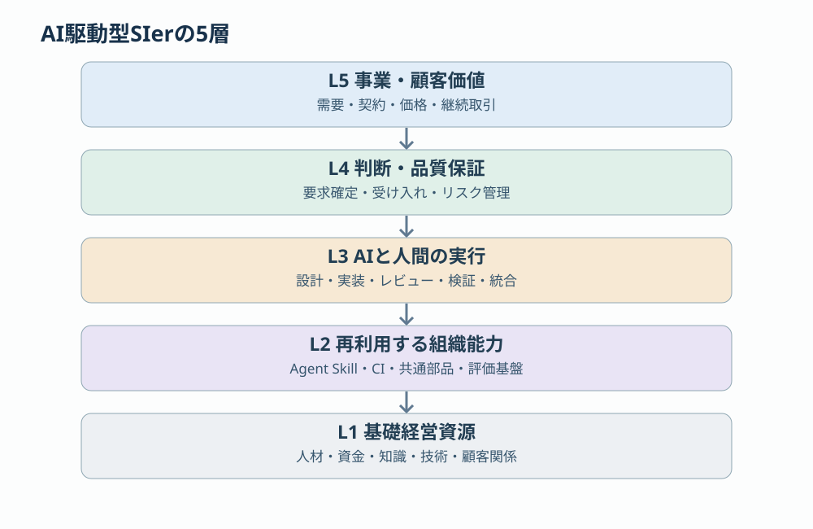
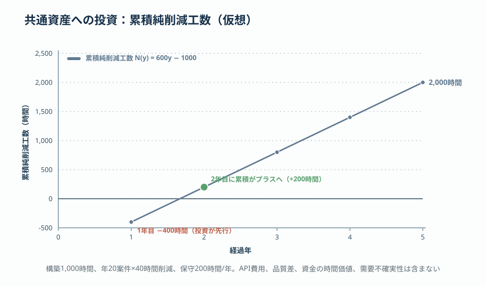

# 第5回 AI時代のSIer経営モデル —— 人月依存から能力蓄積型へ

> [前回：資源配分と制約](04-allocation-constraints.md) ｜ [次回：まとめ](06-series-summary.md) ｜ [目次](../README.md)

## 本稿の結論

AI時代のSIerの経営モデルは、単に「人が行っていた開発作業をAIに代替させる」という話ではない。より本質的な変化は、**企業の生産能力を人材の稼働時間から切り離し、知識・ソフトウェア・AI・組織能力として蓄積できる割合が増える**ことである。

ただし、この変化はすべてのSIerが直ちに人月契約を廃止することを意味しない。生産モデルの変革と、顧客との契約・収益モデルの変革は別の問題である。生産性が上がっても、それを利益として獲得できるかは契約条件、価格交渉、競争環境に依存する。

本稿が推奨する経営方針は、次の3つを同時に進めることである。

1. 人間とAIによる生産活動を統合し、**完成・検証済みの成果**を増やす。
2. 案件で獲得した知識を、繰り返し利用できる**組織資産**へ変換する。
3. 生産性向上で生まれた経済価値を、企業・顧客・従業員に適切に配分し、次の能力形成に再投資する。

## 1. 従来型とAI駆動型の比較

| 経営要素 | 従来型SIer | AI駆動型SIer |
|---|---|---|
| 主要な生産資源 | 人員・専門性・稼働時間 | 人員・組織知・AI・自動化基盤 |
| 生産能力の拡張 | 採用・教育・外注 | 人的能力の増強＋自動化資産の展開 |
| 収益の基礎 | 人月・工数・案件単価 | 成果対価・工数対価・継続サービスの組み合わせ |
| 生産性向上の方法 | 標準化・教育・工程改善 | 標準化＋知識の実行可能化＋AI |
| 主な制約 | 人材供給・実装・テスト | 要求の確定・検証・統合・責任判断 |
| 競争優位 | 人材の専門性・顧客基盤 | これらに加え、知識資産の蓄積と再利用能力 |
| 投資対象 | 人材・設備・案件遂行体制 | 人材・開発基盤・AI・知識資産・評価基盤 |
| 主要KPI | 稼働率、粗利、工数 | 完成速度、検証品質、純便益、資産活用 |

## 2. 研究は何を示しているか

AIによってソフトウェア開発の生産性がどの程度変わるかについて、確認できる研究結果を整理する。

| 調査 | 概要 | 読み方 |
|---|---|---|
| [Google DORA（2025年）](https://cloud.google.com/resources/devops/state-of-devops?hl=ja) | 約5,000人の技術専門職への調査をもとに、AIを組織の既存能力を増幅する要因と捉える | 高い成果にはツール導入だけでなく、開発・検証・組織の仕組みが必要 |
| [METR（2025年）](https://metr.org/blog/2025-07-10-early-2025-ai-experienced-os-dev-study/) ／ [追試報告（2026年2月）](https://metr.org/blog/2026-02-24-uplift-update/) | 2025年の実験では、熟練OSS開発者16名・246タスクでAI利用時に所要時間が19%増加。2026年2月の追試報告では高速化を示唆するデータも得られたが、参加辞退による選択効果などにより効果の大きさは確定できないとし、実験設計を見直すとした | 熟練者・既知コードベースではAIが遅くする場合がある |
| [McKinsey（2025年11月）](https://www.mckinsey.com/industries/technology-media-and-telecommunications/our-insights/unlocking-the-value-of-ai-in-software-development) | 約300社の上場企業の経営層を対象にした調査で、AI活用で高い成果を得た企業群は生産性・市場投入時間・品質の大きな改善を報告 | 役割、プロセス、組織運営の再設計が成果を分ける |
| [富士通（2026年2月）](https://global.fujitsu/ja-JP/technology/key-technologies/ai/ai-dsdp) | AI-Driven Software Development Platformの運用開始を発表。社内検証の1案件で、約3人月の既存システム改修を約4時間で完了し、約100倍の生産性向上と公表 | 企業全体の平均改善率ではなく、単一案件・対象業務・条件に依存する実績 |

これらから導けるのは「AIによって常に開発が高速になる」という結論ではない。AIの経済効果は、適用タスク、組織の既存能力、検証負荷、全体の仕事の流れによって大きく変わる。**経営者が測定すべきなのは、AIの使用率でもコード生成速度でもない。品質を満たした価値提供の速度と、それを実現する総費用である。**

## 3. 5つの経営理論でAI時代のSIerを説明する

第2回で整理した理論を、AI時代に当てはめ直す。

| 理論 | 中心命題 | AI時代への適用 |
|---|---|---|
| 資源ベース理論（RBV） | 競争優位は企業固有の資源・能力から生まれる | 汎用LLMではなく、業務知識と実行能力の組み合わせが差別化要因 |
| 知識ベース理論（KBV） | 企業は専門知識を統合する組織である | Agent Skillや開発標準が知識の統合・実行を支える |
| 取引費用理論 | 内製・外注の境界は取引や調整の費用に依存する | AIによる作業・調整費用の低下が組織境界を変える |
| 制約理論（TOC） | 全体成果は制約によって決まる | 実装の高速化がレビュー・検証の制約を顕在化させる |
| ダイナミック・ケイパビリティ | 資源・能力の再構成が変化への適応を支える | AIモデル・開発工程・人材配置を継続的に再設計する |

### 3.1 RBV：汎用AIはそれ自体では持続的優位になりにくい

同じLLMやコーディングエージェントは、多くの企業が利用できる。したがって汎用ツールの導入だけでは競争優位の持続性は限定的である。一方、次の資源を統合したシステムは模倣が難しくなる。

- 顧客業務の理解と業界固有の要求
- 実際の設計・実装・障害対応から獲得した知識
- 仕様と実装を照合する仕組み
- 自動テスト・品質評価の仕組み
- 技術負債・既知の問題を考慮する判断ルール
- 案件を通じて継続改善されるAgent Skill

競争優位を生む対象は、AIモデル単体から、**企業固有のコンテキストを伴った実行システム**へ移る。

### 3.2 KBV：知識は「文書」から「実行可能な資源」へ

従来の知識管理は、設計標準やノウハウを文書として保存することが中心だった。AI時代には、それらの知識を推論・判断・実行プロセスの入力にできる。例えばテスト設計の標準は次のように変換される。

> 熟練者のテスト設計知識 → 観点・条件・期待結果の形式化 → Agent Skill＋入出力スキーマ＋評価基準 → 案件への実行・検証・フィードバック

ここで重要なのは、文書化された知識と実行可能な知識は同義ではないことである。実行には、対象システムの状態、入力情報の品質、利用権限、実行手順、エラー処理、検証手段が必要になる。

### 3.3 取引費用理論：組織の境界が変化する

ロナルド・コースとオリバー・ウィリアムソンの取引費用理論は、企業がどの業務を内部で行い、どの業務を市場から調達するかを説明する。AIは情報探索、仕様伝達、コード実装などの費用を下げ得る。その結果、従来は人員を増やさなければ対応できなかった仕事を、小さな組織で担える可能性がある。

しかし、AIが常に内製化を促進するわけではない。外部サービスや外部エージェントとの取引費用も下がるため、逆に外部利用が合理的になる場合もある。判断基準は次の比較である。

$$
C_{\text{internal}}\quad\text{vs.}\quad C_{\text{external}}+C_{\text{coordination}}+C_{\text{risk}}
$$

ここには機密性、契約上の責任、品質確認、ベンダーロックインも含めて考える必要がある。

### 3.4 TOC：AIの導入効果は制約の移動として現れる

従来は実装やテストケース作成が時間を要していたとしても、AIの導入によって制約が消えるとは限らない。制約は要求の曖昧さ、レビュー、検証環境、承認、顧客との調整へ移る。したがって「どの作業をAI化したか」ではなく、**「AI化によって全体の制約がどう移動したか」**を測る必要がある（第4回参照）。

### 3.5 ダイナミック・ケイパビリティ：自動化の仕組みそのものを進化させる

AIの技術能力や価格は変わり続ける。特定モデルの使い方を熟知しているだけでは、長期の競争優位を維持しにくい。より重要なのは、モデル更新を検証し、Agent Skillを改善し、作業フローを組み替え、人間の役割を再配分できる能力である。企業が蓄積すべきものは、現在のAIモデルに最適化された手順ではなく、**AIを利用する組織システムを変革し続ける能力**である。

## 4. 5層の経営システム

従来のSIerは、案件を中心に人材を配分し、設計・開発・テストを遂行するモデルが基本だった。AI時代には、案件活動と組織能力の形成活動を明確に分離し、かつ相互接続する必要がある。

| 階層 | 経営上の責任 | 評価すべきもの |
|---|---|---|
| L5 事業 | 顧客価値を収益に変える | 売上総利益、継続率、価値提供 |
| L4 統制 | 品質・リスク・責任を制御する | 欠陥流出、承認時間、重大事故 |
| L3 生産 | 人間とAIで成果物を作る | 完成スループット、工数、リードタイム |
| L2 組織能力 | 生産方法を再利用・標準化する | 資産適用率、実測効果、保守費 |
| L1 資源 | 必要な資源を調達・育成する | 技術力、投資額、調達費、能力充足 |

この5層を別々に管理するのではなく、企業全体の価値創出システムとして管理する。中でも**L2が案件横断の経営資産を形成する層**である。個別案件へAIツールを導入するだけではL3の局所的改善に留まる。L2で共通化し、案件間に横展開することによって、効果が企業全体へ広がる。

## 5. 収益モデル：生産性向上が必ず利益増につながるわけではない

AI駆動型SIerの経営で最も重要な区別の一つが「生産性」と「利益」である。

### 5.1 契約モデルごとの経済効果

| 契約モデル | AIによる効率化の利益 | 主な経営課題 |
|---|---|---|
| 固定価格契約 | 同一価格で総原価が下がれば粗利益が増える | 見積もり、品質リスク、価格競争 |
| 人月・時間精算 | 請求工数が減れば売上も減る場合がある | 単価設計、需要拡大、能力再配分 |
| 成果物・機能単位 | 1成果物あたりの原価低下が利益に反映されやすい | 成果物の定義、品質、変更管理 |
| 継続運用・マネージドサービス | 定額収入に対する運用原価を下げられる | SLA、障害リスク、継続改善 |
| ソフトウェア・プラットフォーム提供 | 多数顧客への再利用で規模の経済が働く | 初期投資、保守、販売、需要 |

### 5.2 同じ工数削減でも契約で利益が変わる

仮想案件：従来工数1,000時間、AI導入後の総工数600時間（レビュー・再作業を含む）、人件費等の原価6,000円/時間、AI実行費・管理費40万円。

| 契約方式 | 従来売上 | AI導入後売上 | 従来粗利益 | 導入後粗利益 | 差 |
|---|---:|---:|---:|---:|---:|
| 固定価格（契約額1,000万円） | 1,000万円 | 1,000万円 | 400万円 | 600万円 | +200万円 |
| 時間精算（請求1万円/時） | 1,000万円 | 600万円 | 400万円 | 200万円 | −200万円 |

いずれも仮想値。時間精算契約では600時間を全額請求できると仮定し、固定価格は契約金額が不変、他の間接費や追加受注は考慮しない。

両者とも実際の労働投入は40%減少している。しかし固定価格契約では原価削減が利益に反映され、時間精算契約では売上減少によって粗利益が下がる。時間精算契約の場合、空いた400時間を別案件の受注に充てられるなら結果は変わる。それは販売能力と需要という別の制約に依存する。

**AIによる生産性の向上と、生産性向上から経済価値を獲得する能力は、別の経営能力である。** AI経営モデルを設計する際には、開発工程の改善と同時に、見積もり方式、価格設定、契約形態、営業モデルの再設計が必要になる。

## 6. 知識資産の蓄積：案件を横断して価値を生む

従来の受託開発では、案件ごとの成果物は顧客に帰属し、ノウハウは個人やチームに留まりやすい。AI時代には、適切な権利処理と機密情報の分離を前提に、案件で得た一般化可能な知識を組織資産へ変換することが重要になる。

### 6.1 知識蓄積のモデル

$$
K_{t+1}=(1-\delta)K_t+\alpha E_t+\beta R_t
$$

- $K_t$：時点 $t$ の利用可能な知識資産
- $\delta$：陳腐化・喪失率
- $E_t$：案件を通じて獲得した経験
- $R_t$：知識資産の改善・研究への投資
- $\alpha,\beta$：各活動が知識資産に変換される効率

これは分析用の単純化モデルであり、各変数には同一尺度への正規化が必要である。この式から3つの示唆が得られる。第一に、案件が増加しても、経験を知識資産へ変換する能力 $\alpha$ が低ければ組織知は十分に増えない。第二に、知識資産は保守しなければ陳腐化する。Agent Skillも例外ではない。第三に、案件経験だけでなく、標準化や研究への継続投資 $R_t$ も必要である。

### 6.2 案件経験から組織資産への変換例

| 案件中の経験 | 変換する資産 | 再利用の対象 |
|---|---|---|
| テスト観点の不足 | テスト設計Skillの検査ルール | 他案件の結合テスト |
| MRで繰り返された指摘 | コードレビューのルール・自動チェック | 全開発リポジトリ |
| CIでの障害対応 | CIライブラリ・運用手順 | 共通開発基盤 |
| デザイン実装の不整合 | UI設計標準・コンポーネント | 複数の画面開発 |
| 性能障害の分析 | 性能測定・ログ分析Skill | 他案件の性能試験 |
| 設計とコードの乖離 | 整合性検証Agent | 保守開発案件 |

ただし、共通化の対象には選別が必要である。顧客固有情報、案件固有の業務ルール、機密設計をそのまま再利用してはいけない。蓄積するのは、権利・機密上の条件を満たす一般化可能な方法、標準、評価基準、汎用的な実装である。

### 6.3 知識資産の価値をどう測るか

Agent Skillの数を集計しても、経営資産の価値はわからない。次のように測定する。

$$
V_{\text{asset}}=\sum_{i=1}^{n}\left(\Delta C_i-C_{\text{apply},i}\right)-C_{\text{build}}-C_{\text{maint}}
$$

- $\Delta C_i$：案件 $i$ で回避した原価
- $C_{\text{apply},i}$：案件適用のための追加費用
- $C_{\text{build}}$：資産の構築費用
- $C_{\text{maint}}$：保守費用

異なる時点の金銭価値を比較する場合は、さらに割引現在価値を適用する。重要なのは、**資産の価値を開発工数で評価しないこと**である。500時間かけて開発したSkillでも、実際に使われなければ経済効果は乏しい。50時間で構築し、数百案件へ適用されるSkillの方が高い価値を持つ場合がある。

### 6.4 投資回収シミュレーション

仮想設定：共通Skill構築に1,000時間、年間20案件で各40時間削減、年間保守200時間。毎年の利用量と効果が一定だとする。

$$
N_y=y\times(20\times40-200)-1000=600y-1000
$$

$N_y$ は $y$ 年後の累積純削減工数。

| 経過年 | 累積純削減工数 |
|---:|---:|
| 1 | -400時間 |
| 2 | 200時間 |
| 3 | 800時間 |
| 4 | 1,400時間 |
| 5 | 2,000時間 |

[計算データCSV](../simulation/05-asset-investment.csv)。API費用、導入前後の品質差、資金の時間価値、需要不確実性は含まない。利用案件数が想定を下回れば回収年は後ろにずれ、保守を怠れば $\delta$ の上昇として効果が目減りする。

## 7. 生産システム：AIエージェントを「労働力」ではなく制御対象として設計する

AI時代のSIerでは、人材配置だけでなく、AIエージェントへの仕事の割り当てと結果の検証を組織的に管理する必要がある。ここではAIエージェントを、労働契約上の従業員ではなく、権限・入力・成果物・評価基準を持つソフトウェア実行主体として扱う。

### 7.1 人間とAIの責務分離

| 活動 | AIの責務 | 人間の責務 |
|---|---|---|
| 要求分析 | 仕様抽出、矛盾検出、質問生成 | 業務意図・受け入れ条件の確定 |
| 設計 | 設計案生成、標準適合性検証 | アーキテクチャ判断・例外承認 |
| 実装 | コード生成、静的チェック、修正 | 重要変更の判断・統合責任 |
| テスト | 観点生成、ケース作成、実行 | 検証戦略、品質リスクの受容 |
| レビュー | 規則チェック、影響分析、指摘案 | リスクに応じた承認・判断 |
| リリース | 手順実行、確認、証跡収集 | リリース可否と事業リスク判断 |

これは人間がすべてを逐一確認する方式を意味しない。低リスクかつ十分に検証可能な作業は自動実行・自動統合し、高リスクな作業は追加検証や人間の承認を求める方式が合理的である。

### 7.2 自律度はリスクと検証可能性で決める

| 自律度（提案分類） | 実行範囲 | 例 |
|---|---|---|
| L0 提案 | AIは提案のみ、人間が判断 | 要求の曖昧性指摘 |
| L1 生成 | 成果物を生成、人間が採否を決定 | テストケース生成 |
| L2 検証付き実行 | AIが実行し、証跡を残す | テスト自動実行 |
| L3 条件付き統合 | 基準を満たせば自動反映 | 低リスク変更の自動MRマージ |
| L4 統制された自律運用 | 定義済み範囲で一連の工程を遂行 | 許可範囲内の変更・検証・デプロイ |

この区分は提案モデルであり、業界共通の公的な自律度規格ではない。ポイントは、AIの能力だけで自律度を決定しないことである。**AIの自律範囲は、失敗の影響と、独立した検証によって失敗を検出できる確率で決める。** UIコンポーネントの表示修正と決済金額の計算ロジック変更とでは、必要な検証と承認の強度は異なる。

## 8. 制約モデル：AI導入後に何がボトルネックになるか

AIによって実装工程が高速化しても、全体のスループットが比例して増えるわけではない。第4回の工程モデルを、AI導入後の能力で置き直す。

| 工程 | 処理能力（件/日） |
|---|---:|
| 設計 | 20 |
| 実装 | 40 |
| レビュー | 12 |
| 検証 | 18 |
| リリース | 15 |
| **全体の理論処理能力上限** | **12（制約工程：レビュー）** |

全作業が5工程を1回ずつ通過し、各件の作業量が同一で、手戻り・変動・並列処理の干渉を無視した仮想モデルである。実際の完了率は需要と工程運営によって上限以下になる。

実装能力40件/日に対し、レビュー能力は12件/日である。実装能力をさらに増やすより、レビュー工程の負荷を減らす施策の方が全体の処理能力向上に寄与する。ただしレビュー能力を改善すると、今度はリリース工程15件/日が制約になり得る。

### 8.1 AI時代に新たに管理すべき資源

AI導入によって、従来は目立たなかった資源が経営管理の対象になる。

| 新しい管理対象 | 内容 | 指標 |
|---|---|---|
| AI実行能力 | モデル呼び出し、並列実行、実行時間 | 実行コスト、待ち時間、成功率 |
| コンテキスト品質 | 仕様、コード、ルールの正確性・到達性 | 不足情報率、誤参照率 |
| 検証能力 | AI成果物を評価する仕組み | 自動検証カバレッジ、見逃し率 |
| 権限・統制能力 | AIが実行できる操作の範囲 | 承認待ち、権限違反、事故 |
| 統合能力 | 複数AIや人間の成果をまとめる能力 | コンフリクト、統合時間、手戻り |

AIを大量に並列起動できても、結果を検証・統合できなければ、経営上の生産能力は増えない。**これがAI時代の制約理論の中心問題である。**

## 9. 組織モデル：案件組織と資産組織を分離する

AI駆動型SIerでは、案件遂行と共通能力開発を同じ責任体系で管理すると、共通資産への投資が短期案件の優先順位に押し負けやすい。そこで組織を3つの責任領域に分けることを推奨する。

1. **事業・案件組織**：顧客価値・納期・収益・品質の責任を持つ。共通資産の実利用者であり、改善要求を提供する。
2. **プラットフォーム・能力開発組織**：開発標準、CIライブラリ、Agent Skill、評価基盤、共通コンポーネントの保守・展開を担う。
3. **探索・変革組織**：新しいAI能力を検証し、将来の開発プロセス・事業モデルを設計する。PoCの終了・移管・撤退を判断する。

これは必ずしも3つの独立した部門を設けるという意味ではない。小規模組織なら同じメンバーが兼務してよい。ただし、予算、責任、成果指標は分ける。

特にプラットフォーム・能力開発組織を単なる社内開発支援チームとして扱わないことが重要である。この組織の提供物は、案件の将来原価と生産能力に影響する経営資産である。したがって、リリース管理、品質保証、ユーザーサポート、廃止判断までの責任を持つべきである。

## 10. 経営資源の循環モデル：複利的に能力を蓄積する

第3回のStock・Flowの枠組みで、AI時代のSIerを6つのストックとフローで捉える。

| ストック | 増加要因 | 減少・劣化要因 |
|---|---|---|
| 人的能力 | 教育、案件経験、採用 | 退職、技能の陳腐化 |
| 知識資産 | 経験の形式化、検証、改善 | 未更新、情報喪失 |
| 自動化資産 | Skill開発、CI整備、共通化 | モデル変更、依存更新、保守不足 |
| 顧客関係 | 価値提供、信頼形成 | 品質事故、顧客環境の変化 |
| 財務資源 | 利益、回収、資金調達 | 投資、費用、資金流出 |
| 組織能力 | 知識・人材・技術の統合 | 人員変更、手順の形骸化 |

目指すのは次の強化循環である。

1. 案件を遂行する。
2. 案件から改善可能な知識を抽出する。
3. 知識を標準・Agent Skill・CIへ変換する。
4. 次の案件の実行工数や品質リスクを減らす。
5. 生み出した利益や余力を再投資する。
6. 組織能力を高め、より高い価値の案件へ適用する。

これは組織学習と資産蓄積による強化ループである。ただし、放置すると無限に成長するわけではない。共通資産が増えるほど保守費用や統合の複雑性が増す可能性があり、顧客需要の不足も成長を制限する。再利用による便益と複雑性の増加を継続的に比較する必要がある。

## 11. 経営ダッシュボード：AI活用率ではなく企業価値を測定する

AI駆動型SIerには、最低でも次の5領域の経営指標が必要である。

| 領域 | 主要KPI | 問い | 測定上の注意 |
|---|---|---|---|
| 財務 | 案件粗利益率、共通資産投資回収率 | AI活用が経済価値を生んだか | 受注条件・請求方式の影響を分離する |
| 生産 | 完成スループット、リードタイム、手戻り工数 | 仕事の完了速度が改善したか | 作業サイズ・難度を区分する |
| 品質 | 欠陥流出率、重大障害、検証成功率 | 高速化で品質が劣化していないか | AI導入前後で測定条件をそろえる |
| 資産 | 共通資産適用率、純削減工数、保守費 | 将来の生産能力が蓄積しているか | 数だけを成果としない |
| 組織 | 自律実行率、例外対応負荷、能力移転率 | 人間とAIの役割分担が進化したか | タスクの母集団・合格基準を固定する |

特に重要なのが、次の3つの独自指標である。

**① 検証済み自律完了率**

$$
R_{\text{autonomous}}=\frac{\text{AIが自律実行し所定の検証を通過した対象タスク数}}{\text{対象タスク総数}}
$$

人間の修正を必要とせずに所定の品質基準を満たしたタスクの割合として定義する。単なる「AI生成率」より実際の生産能力を測定しやすい。ただし、タスク難度・サイズ別の区分が必要である。

**② 共通資産の純経済効果**

$$
B_{\text{net}}=\text{回避原価}-\text{構築費用}-\text{適用費用}-\text{保守費用}
$$

AIや共通資産が生み出す価値を、導入・維持にかかる総費用から評価する（6.3の $V_{\text{asset}}$ の運用形）。

**③ 資産再投資率**

$$
R_{\text{reinvest}}=\frac{\text{共通能力の構築・改善への投資額}}{\text{対象活動から創出された投資可能な経済便益}}
$$

この比率は企業の資金配分方針を表すものであり、高いほど優れている指標ではない。維持投資、成長投資、利益還元とのバランスで判断する。

## 12. AI駆動型SIerへの移行ロードマップ

経営の移行は、ツール導入から始めるのではなく、生産・検証・資産化の仕組みを順に構築する。

| 段階 | 経営上のテーマ | 完了判定 |
|---|---|---|
| 第1段階 | 現状の生産能力と制約を測定する | 工程別工数、完了率、品質、滞留を把握した |
| 第2段階 | AIを個別工程へ適用する | 対照条件と比較して総工数・品質の改善を確認した |
| 第3段階 | 設計・実装・検証を連結する | 工程間の受け渡しと自動検証を確立した |
| 第4段階 | 案件横断の組織資産を形成する | 複数案件で再利用され、純便益を計測した |
| 第5段階 | 収益・組織モデルを転換する | 価格設計、資源配分、責任体系へ反映した |
| 第6段階 | 自律的な能力改善を実現する | 実行結果が標準・Skill・評価基準の改善につながっている |

初期段階で全社統一を狙うより、代表的な複数案件で実測し、適用できる領域と適用できない領域を明確に分ける方が合理的である。

### 優先順位の高い4施策

SIerの開発生産性改革を推進する立場では、特に次の4施策を優先することを推奨する。

1. **GitLabを生産フローの観測基盤にする。** Issue、MR、CI、テスト結果をつなぎ、作業流入から完成までの制約を可視化する。
2. **Agent Skillを組織資産として管理する。** 所有者、利用者、実行成功率、評価データ、保守コストを持たせ、資産ポートフォリオとして管理する。
3. **検証能力への投資を先行させる。** コード生成能力よりも、仕様整合、回帰テスト、非機能試験、AIレビュー評価などの検証基盤を拡張する。
4. **案件での改善成果を共通資産へ還元する仕組みを作る。** 案件の完了条件とは別に、再利用可能な知識の抽出・評価・登録・展開を管理する。

## 13. 最終結論：AI時代のSIerは何を売る企業になるのか

従来のSIerは、顧客のシステム開発に必要な専門的労働を組織的に供給することで価値を生み出してきた。AI時代には、開発に必要な実行能力の一部をソフトウェアとして複製・展開できるようになる。その結果、企業の価値は、人材の供給能力だけでは説明できなくなる。

> AI駆動型SIerとは、顧客固有の要求を、企業が蓄積した知識・技術・AI実行能力を使って検証済みのシステム価値へ変換し、その過程で次の生産能力を形成する企業である。

この定義では、重要な競争力は4つある。

1. **要求を定義する能力**：顧客の業務課題を、実装・検証可能な仕様へ変換する。
2. **自律実行する能力**：人間とAIを組み合わせて設計・開発・テストを完遂する。
3. **品質を保証する能力**：出力の正しさを証拠に基づいて評価し、リスクに応じて判断する。
4. **能力を再生産する能力**：一度獲得した知識を組織全体へ展開し、次の案件で活用する。

経営の評価軸も変える必要がある。従来の「何人を何時間稼働させたか」に加えて、**「いくらの価値を生み出し、どれだけの組織能力を新たに形成し、その能力をいかに更新できるか」**を測定する。概念的には次のように表せる。

$$
\text{持続的競争力}=f(\text{要求理解},\ \text{自律実行},\ \text{検証能力},\ \text{知識蓄積},\ \text{変革能力})
$$

これは実証済みの定量公式ではなく、経営戦略を構成する要因を示す概念モデルである。

重要なのは、人間の生産性を高めるだけでは不十分だということである。人間の活動によって生まれた知識を組織の実行能力に変換し、その能力がさらに新しい知識と経済価値を生み出す。この循環を企業の中核システムとして設計することが、AI時代のSIer経営の中心課題になる。

**本稿の問い**：このモデルを実際の経営制度に落とし込めるか。案件利益と共通資産の投資負担をどう分けるか、組織能力を誰の成果として評価するか、AIで浮いた工数を誰がどこへ再配分するか——予算・人事評価・権限配分の再設計が、本連載の次の論点である。

[第6回：まとめ —— 資源から制約へ、制約から経営モデルへ](06-series-summary.md)

### 参考文献・追加資料

- Jay B. Barney, “Firm Resources and Sustained Competitive Advantage,” *Journal of Management*, 1991. https://doi.org/10.1177/014920639101700108
- Robert M. Grant, “Toward a Knowledge-Based Theory of the Firm,” *Strategic Management Journal*, 1996. https://doi.org/10.1002/smj.4250171110
- Ronald H. Coase, “The Nature of the Firm,” 1937. https://doi.org/10.1111/j.1468-0335.1937.tb00002.x
- Oliver E. Williamson, *Markets and Hierarchies*, 1975.
- David J. Teece, Gary Pisano, Amy Shuen, “Dynamic Capabilities and Strategic Management,” 1997. https://doi.org/10.1002/(SICI)1097-0266(199708)18:7%3C509::AID-SMJ882%3E3.0.CO;2-Z
- David J. Teece, “Explicating Dynamic Capabilities,” 2007. https://doi.org/10.1002/smj.640
- James G. March, “Exploration and Exploitation in Organizational Learning,” 1991. https://doi.org/10.1287/orsc.2.1.71
- DORA (Google), *2025 DORA State of AI-assisted Software Development Report*, 2025. https://cloud.google.com/resources/devops/state-of-devops?hl=ja
- METR, “Measuring the Impact of Early-2025 AI on Experienced Open-Source Developer Productivity,” 2025. https://metr.org/blog/2025-07-10-early-2025-ai-experienced-os-dev-study/
- METR, “We are Changing our Developer Productivity Experiment Design,” 2026-02-24. https://metr.org/blog/2026-02-24-uplift-update/
- McKinsey & Company, “Unlocking the value of AI in software development,” 2025-11-03. https://www.mckinsey.com/industries/technology-media-and-telecommunications/our-insights/unlocking-the-value-of-ai-in-software-development
- 富士通, 「AIエージェントによるシステム開発の刷新 AI-Driven Software Development Platform」, 2026年2月17日発表. https://global.fujitsu/ja-JP/technology/key-technologies/ai/ai-dsdp（報道例：https://news.mynavi.jp/techplus/article/20260217-4137042/）
