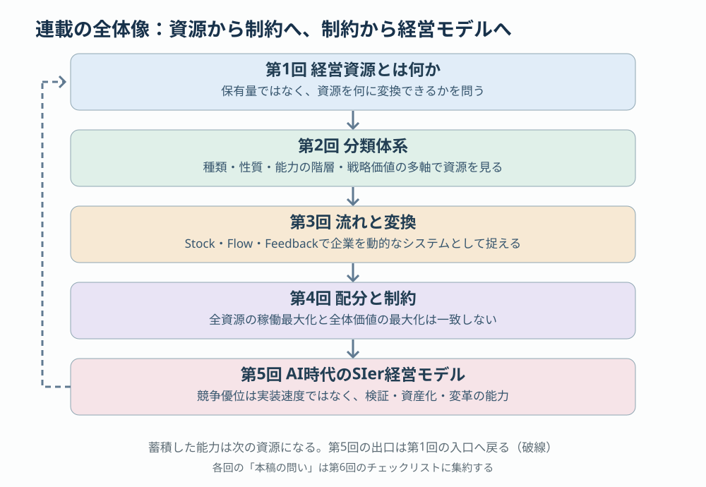
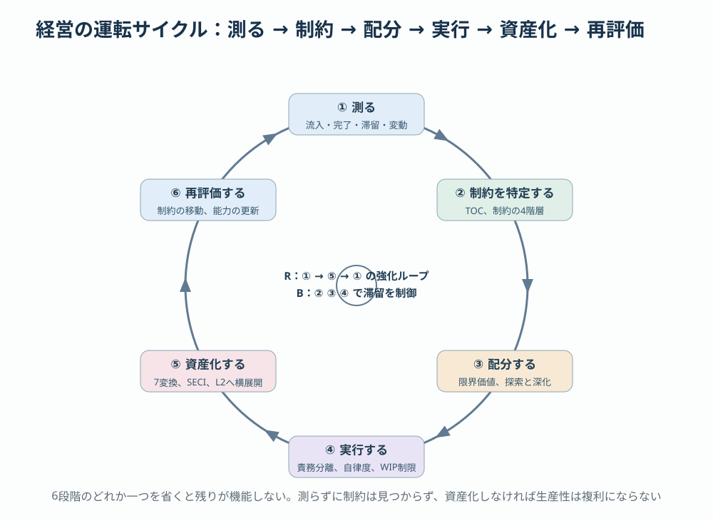

# 第6回 まとめ —— 資源から制約へ、制約から経営モデルへ

> [前回：AI時代のSIer経営モデル](05-ai-sier-model.md) ｜ [目次](../README.md) ｜ 最終回

## 本稿の結論

本連載は、SIerの経営を「人月を何人投入したか」ではなく、**「資源を何に変換し、何が全体を制約し、どれだけの能力が組織に残ったか」**で捉え直す試みだった。5回を貫く主張は3つに集約できる。

1. **保有ではなく変換。** 経営資源の価値は保有量ではなく、何に変換できるか、そして変換の成果が次の活動の資源になるかで決まる（第1回・第2回）。
2. **総量ではなく流れと制約。** 企業はStock・Flow・Feedbackからなるシステムであり、全資源の稼働を最大化しても全体の価値は最大化しない。成果は制約が決める（第3回・第4回）。
3. **現在の価値と将来の能力は別の成果。** AI時代のSIerの競争優位は実装速度ではなく、検証し、資産化し、仕組みそのものを変革し続ける能力にある（第5回）。

本稿では、5回の議論を一本の線に束ね、概念と数式の対応表、経営の運転サイクル、チェックリストとしてまとめる。各回を読んでいない読者は、本稿を入口にして必要な回へ戻れる。

## 1. 連載の全体像

| 回 | 問い | 中心概念 | 一行の答え |
|---|---|---|---|
| [第1回](01-management-resources.md) | 経営資源とは何か | 保有と変換、7資源、5つの視点 | 資源は変換して初めて価値になり、成果は次の資源になる |
| [第2回](02-resource-taxonomy.md) | 資源をどう分類するか | 7分類、性質、Resource／Capability／Dynamic Capability、8軸、3つの価値 | 種類だけでなく性質・能力階層・戦略価値で見る。保有量と組織能力は比例しない |
| [第3回](03-stock-flow-transformation.md) | 資源はどう流れ、変換されるか | Stock・Flow・Feedback、7変換、SECI、4循環 | 企業は資源変換システムであり、二重の成果（現在の価値と将来の能力）を持つ |
| [第4回](04-allocation-constraints.md) | 限られた資源をどこへ配分するか | 制約理論、機会費用、シャドープライス、待ち行列、探索と深化 | 全体を制約する要因に投資し、制約の移動を追い続ける |
| [第5回](05-ai-sier-model.md) | AI時代のSIerは何を売る企業になるか | 5層モデル、収益モデル、知識資産、自律度、3組織、ロードマップ | 要求を検証済みの価値へ変換し、その過程で次の生産能力を形成する企業 |

第5回の出口は第1回の入口へ戻る。蓄積した組織能力は次の案件の資源になり、同じ問いが一段高い水準で繰り返される。

## 2. 連載を貫く5つの命題

**命題1：資源は保有量ではなく、提供するサービスと変換先で評価する。**（第1回・第2回）
ペンローズが示した通り、同じ技術者1人でも配置によって得られるサービスは異なる。資源台帳に必要なのは「何を持つか」ではなく「どこで使われ、何を生み、いつ陳腐化するか」である。

**命題2：資源と能力は別物であり、能力はさらに2階層に分かれる。**（第2回）
Resourceを組み合わせて成果を反復するのがCapability、そのCapabilityを作り替えるのがDynamic Capabilityである。Agent Skillを100個持つことと、10個のSkillで多数の案件の品質と生産性を反復して改善することは、まったく異なる。

**命題3：企業はStock・Flow・Feedbackのシステムであり、強化ループと抑制ループが同時に働く。**（第3回）
経験が標準やSkillに還流すれば生産性は複利で上がる。実装だけ速くなればレビュー待ちが増えて完了量は頭打ちになる。どちらのループが支配的かは、仕組みの設計で決まる。

**命題4：全資源の稼働最大化と全体価値の最大化は一致しない。配分は制約と限界価値で決める。**（第4回）
制約理論は「何が現在の成果を制限しているか」を、資源配分論は「どこへ投資するか」を、経営戦略は「将来どのような制約構造の企業になるか」を扱う。不足しているという印象と、追加投資の限界価値は一致しない。

**命題5：AI時代の競争優位は実装速度ではなく、検証・資産化・変革の能力である。**（第5回）
汎用LLMは誰でも使える。模倣が難しいのは、業務知識・検証基盤・Agent Skillを統合した実行システムと、それを更新し続ける組織である。生産性の向上と利益の獲得は別の経営能力であり、契約・価格・組織制度の再設計を伴う。

## 3. 主要概念の対応表

| 概念 | 定義 | 初出 | SIerでの観測点 |
|---|---|---|---|
| 経営資源 | 価値創出のために投入・蓄積・配分する資源 | 第1回 | 7分類の資源台帳 |
| 変換 | 資源の用途・価値創出機能を変える過程 | 第1回・第3回 | 7変換類型ごとの入出力 |
| 組織能力（Capability） | 複数の資源を組み合わせ、成果を反復して生む能力 | 第2回 | 実利用率、再現性、純削減工数 |
| 変革能力（Dynamic Capability） | 既存の資源・能力を再構成する能力 | 第2回・第5回 | 能力変更の所要時間、モデル更新への追随 |
| Stock／Flow | ある時点の蓄積量／一定期間の増減速度 | 第3回 | 未完了MR、マージ数/日、知識資産指数 |
| 生産的／滞留／リスクStock | 将来の能力を高める蓄積／価値創出前の拘束／将来の費用要因 | 第3回 | 共通資産、レビュー待ち、技術負債 |
| 二重の成果 | 現在の価値創出と、将来の価値創出能力の形成 | 第1回・第3回 | 粗利益と、資産適用率・純便益 |
| 制約（Constraint） | 全体成果の上限を規定する条件 | 第4回 | 工程別処理能力、承認待ち、要求確定 |
| シャドープライス | 制約資源を1単位増やしたときの目的関数の改善量 | 第4回 | 実装1時間とレビュー1時間の限界価値 |
| 探索と深化 | 新能力の探索と既存能力の活用への配分 | 第4回 | 技術投資工数の配分比と評価ルール |
| 知識資産 $K_t$ | 利用可能な知識資産の量（陳腐化と変換効率を持つ） | 第3回・第5回 | 検証済み知識の再利用件数、保守頻度 |
| 検証済み自律完了率 | AIが自律実行し所定の検証を通過したタスクの割合 | 第5回 | タスク難度別の自律完了率 |
| 共通資産の純便益 | 回避原価から構築・適用・保守費用を引いた値 | 第5回 | 資産ポートフォリオの純経済効果 |

## 4. 数式を一本に束ねる

連載で使った数式は、問いの階層ごとに分かれている。

| 問い | 式 | 使いどころ | 落とし穴 | 回 |
|---|---|---|---|---|
| 資源はどう増減するか | $S_{t+1}=S_t+A_t-D_t$ | 知識・技術資産・信用などの蓄積と劣化 | 「蓄積数」だけを数えると使えない古い資産も計上する | 第2回・第3回 |
| 知識資産はどう蓄積するか | $K_{t+1}=(1-\delta)K_t+\alpha E_t+\beta R_t$ | 案件経験の資産化効率 $\alpha$ と改善投資 $R_t$ の評価 | 変数の正規化なしに異種の情報を加算しない | 第3回・第5回 |
| 仕事はどれだけ滞留するか | $L=\lambda W$、$W_q=\dfrac{\rho}{\mu(1-\rho)}$ | WIP・リードタイム・稼働率の関係 | モデル上の値であり実測の予測ではない。高稼働は待ち時間を非線形に増やす | 第4回 |
| 資源をどこへ配分するか | $\max V(\mathbf{x})\ \text{s.t.}\ A\mathbf{x}\le\mathbf{b}$、$MV_i=\partial V/\partial x_i$ | 限界価値とシャドープライスによる比較 | 分割不能性。数理的最適と組織として実行可能な配分は別 | 第4回 |
| 共通資産は割に合うか | $V_{\text{asset}}=\sum_i(\Delta C_i-C_{\text{apply},i})-C_{\text{build}}-C_{\text{maint}}$ | 資産の経済価値、投資回収 | 開発工数で価値を測らない。使われない資産は価値を持たない | 第2回・第3回・第5回 |
| 内製か外注か | $C_{\text{internal}}$ vs. $C_{\text{external}}+C_{\text{coordination}}+C_{\text{risk}}$ | AIによる取引費用低下後の組織境界 | 機密性・契約責任・ロックインを費用に含める | 第5回 |

上から順に「蓄積 → 流れ → 配分 → 投資評価 → 境界」という階層になっている。下の問いは上の問いの答えを前提にする。例えば滞留を測らずに配分を決めることはできず、資産の価値を測らずに内製と外注を比べることはできない。

## 5. 統合モデル：AI時代のSIer経営の運転サイクル

5回の内容を、経営が繰り返し回す6段階のサイクルとして統合する。

| 段階 | 何をするか | 使う道具 | 主要な指標 | 該当回 |
|---|---|---|---|---|
| ① 測る | 流入・完了・滞留・変動を観測し、資源台帳を8軸で持つ | GitLabのIssue／MR／CI、Skill実行記録 | MR作成数・マージ数・Open MR・初回レビュー待ち・リードタイム | 第2回・第3回・第4回 |
| ② 制約を特定する | 全体成果を制限している工程・制度・市場要因を見つける | TOCの5ステップ、制約の4階層 | 工程別処理能力の最小値、承認待ち、要求確定の遅れ | 第4回 |
| ③ 配分する | 限界価値が最も高い制約へ資源を集中し、探索・深化・現在の事業に時間軸別に配分する | シャドープライス、探索と深化、段階投資 | 追加1時間・100万円の限界価値、配分比率と評価ルール | 第4回 |
| ④ 実行する | 人間とAIの責務を分け、リスクと検証可能性に応じた自律度で生産する | 責務分離表、自律度L0〜L4、WIP制限 | 完成スループット、検証済み自律完了率、欠陥流出率 | 第5回 |
| ⑤ 資産化する | 案件経験を標準・Skill・CI・評価データへ変換し、L2で横展開する | 7変換類型、SECI、プラットフォーム組織 | 共通資産適用率、純削減工数、保守費、$\alpha$ | 第3回・第5回 |
| ⑥ 再評価する | 制約の移動とモデルの変化に合わせて配分と仕組みを更新する | 制約の再評価、ダイナミック・ケイパビリティ | 次の制約工程、能力変更所要時間、資産再投資率 | 第4回・第5回 |

このサイクルは、第3回の強化ループ（①→⑤→①）を回しながら、抑制ループ（AI導入による滞留）を②③④で制御する構造になっている。6段階のどれか一つを省くと、残りが機能しない。測らずに制約は見つからず、制約を見ずに配分すれば稼働率最大化に戻り、資産化しなければ生産性は複利にならず、再評価しなければ古い制約に投資し続ける。

## 6. 経営者のためのチェックリスト

各回の「本稿の問い」と、そこから派生する確認項目を集める。すべてに「はい」と答えられる組織は多くない。「いいえ」の項目が、次の投資先の候補である。

**資源（第1回・第2回）**

- [ ] 案件活動で得た経験を、次の案件へ利用できる資源に変える仕組みがあるか。
- [ ] 資源台帳は「何を持つか」だけでなく、「どこで使われ、何を生み、いつ陳腐化するか」まで表現できるか。
- [ ] Agent Skillや共通部品を、保有数ではなく実利用率と純削減工数で評価しているか。
- [ ] 買える資源（APIやツール）と、蓄積しなければ得られない資源（検証の習慣、システム固有のテスト知識）を区別して投資しているか。

**流れ（第3回）**

- [ ] 案件経験から共通資産への流れを、実際に追跡・評価できるか。
- [ ] 未完了MRの増加を「成果の蓄積」ではなく「滞留」として扱っているか。
- [ ] 生産循環の最適化が、知識循環と能力循環を毀損していないか。

**配分と制約（第4回）**

- [ ] いま追加1時間・追加100万円の価値が最も高い資源は何か、答えられるか。
- [ ] 改善によって次の制約がどこへ移動するか、見通しを持っているか。
- [ ] 非制約工程の稼働率を意図的に下げる判断ができているか。
- [ ] 探索投資を短期ROIだけで打ち切っていないか。逆に、撤退条件なしに続けていないか。

**AI時代の経営モデル（第5回）**

- [ ] AIの使用率やコード生成速度ではなく、品質を満たした価値提供の速度と総費用を測っているか。
- [ ] 生産性向上を利益に変えるために、契約・価格・営業モデルの再設計に着手しているか。
- [ ] AIの自律範囲を、AIの能力ではなく、失敗の影響と独立検証で検出できる確率で決めているか。
- [ ] プラットフォーム・能力開発組織に、予算・責任・成果指標を案件組織と分けて与えているか。
- [ ] このモデルを予算・人事評価・権限配分という制度に落とし込めているか。

## 7. よくある誤りと連載の答え

| よくある判断 | なぜ誤りか | 連載の答え | 回 |
|---|---|---|---|
| AI使用率やコード生成量をKPIにする | 個人の生産性と企業の価値提供速度は別。検証・統合で滞留すれば完了量は増えない | 完成スループット、検証済み自律完了率、総費用を測る | 第4回・第5回 |
| 全員の稼働率100%を目指す | 変動のある工程では高稼働が待ち時間を非線形に増やす | 余力は無駄ではなく機能。WIP制限と制約への従属 | 第4回 |
| Skillや共通部品の数を成果にする | 使われない資産は経済価値を持たず、保守費だけが残る | 実利用率、純削減工数、$V_{\text{asset}}$ で評価する | 第2回・第5回 |
| 実装の高速化をそのまま納期短縮と見なす | 制約がレビュー・検証・承認・要求確定へ移動するだけ | 制約の移動を測り、次の制約へ投資する | 第4回・第5回 |
| 人月単価のまま生産性だけ上げる | 時間精算では請求工数の減少が売上減になる | 契約形態・価格・成果定義を再設計する | 第5回 |
| 共通資産開発を案件組織の片手間に置く | 短期案件の優先順位に常に押し負ける | 予算・責任・指標を分けた能力開発組織を置く | 第5回 |
| 「人手不足」で制約を一括りにする | 能力・フロー・制度・市場で対策がまったく違う | 制約の4階層で切り分ける | 第4回 |
| 文書化すれば知識が組織能力になると考える | 文書化された知識と実行可能な知識は同義ではない | 入力・手順・検証・教育と接続して初めて能力になる | 第2回・第3回・第5回 |

## 8. 本連載が扱わなかったこと

連載で意図的に範囲外とした論点を挙げる。いずれも本連載の枠組みの続きとして扱える。

- **組織構造と境界。** なぜ企業は階層化・専門分化するのか。AIで調整費用が下がると組織の最適な境界はどう変わるか。取引費用理論、必要多様性の法則、一般システム理論との接続が必要になる（第4回末尾で言及）。
- **制度設計。** 案件利益と共通資産の投資負担をどう分けるか、組織能力を誰の成果として評価するか、AIで浮いた工数を誰がどこへ再配分するか。予算・人事評価・権限配分の再設計である（第5回末尾で言及）。
- **顧客側の変化。** 顧客の調達・契約・内製化の判断がAIでどう変わり、SIerの収益モデルにどう跳ね返るか。
- **実測。** 本連載の数値例はすべて仮想値である。自組織で使うには、まず4週間程度の基準値を取得し、介入の前後で流入量・作業サイズ・品質・リードタイムを比較する必要がある。

## 9. 最後に

5回を通じて繰り返したのは、一つの転換である。**人間の労働時間を売る企業から、労働から生まれた知識を組織の実行能力に変え、その能力がさらに新しい知識と経済価値を生む循環を設計する企業へ。** 制約理論は現在を、資源配分論は投資先を、経営戦略は将来の制約構造を扱う。AI時代のSIer経営とは、この三つを一つのサイクルとして回し続けることである。

**本稿の問い**：自社はこの運転サイクルのどの段階で止まっているか。

### 参考文献（連載主要文献）

- Edith Penrose, *The Theory of the Growth of the Firm*, 1959.
- Jay B. Barney, “Firm Resources and Sustained Competitive Advantage,” *Journal of Management*, 1991. https://doi.org/10.1177/014920639101700108
- Ingemar Dierickx and Karel Cool, “Asset Stock Accumulation and Sustainability of Competitive Advantage,” *Management Science*, 1989. https://doi.org/10.1287/mnsc.35.12.1504
- Robert M. Grant, “Toward a Knowledge-Based Theory of the Firm,” *Strategic Management Journal*, 1996. https://doi.org/10.1002/smj.4250171110
- David J. Teece, Gary Pisano, Amy Shuen, “Dynamic Capabilities and Strategic Management,” 1997. <https://doi.org/10.1002/(SICI)1097-0266(199708)18:7%3C509::AID-SMJ882%3E3.0.CO;2-Z>
- David J. Teece, “Explicating Dynamic Capabilities,” 2007. https://doi.org/10.1002/smj.640
- Jay W. Forrester, *Industrial Dynamics*, 1961.
- Ikujiro Nonaka, “A Dynamic Theory of Organizational Knowledge Creation,” *Organization Science*, 1994. https://doi.org/10.1287/orsc.5.1.14
- Eliyahu M. Goldratt and Jeff Cox, *The Goal*, 1984.
- John D. C. Little, “A Proof for the Queuing Formula: L = λW,” *Operations Research*, 1961. https://doi.org/10.1287/opre.9.3.383
- James G. March, “Exploration and Exploitation in Organizational Learning,” *Organization Science*, 1991. https://doi.org/10.1287/orsc.2.1.71
- Ronald H. Coase, “The Nature of the Firm,” 1937. https://doi.org/10.1111/j.1468-0335.1937.tb00002.x
- METR, “Measuring the Impact of Early-2025 AI on Experienced Open-Source Developer Productivity,” 2025. https://metr.org/blog/2025-07-10-early-2025-ai-experienced-os-dev-study/
