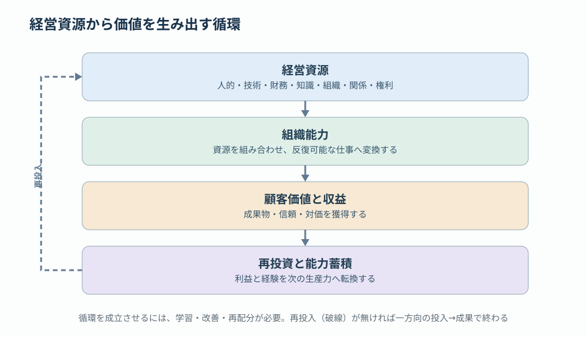

# 第1回 経営資源とは何か —— 保有から変換へ

> **連載：AI時代のSIer経営を資源から再設計する（全5回）**  
> 前回：なし ｜ [次回：分類体系](02-resource-taxonomy.revised.md) ｜ [目次](../README.md)

## 本稿の結論

経営資源とは、企業が価値を創出し、競争優位を形成・維持するために投入、蓄積、配分する資源である。伝統的には「ヒト・モノ・カネ・情報」の4つに分類される。しかし現代の企業経営、とりわけSIerやソフトウェア企業では、この4分類だけでは十分ではない。

本稿の立場は次の一点にある。**経営の本質は資源の保有ではなく、資源の変換にある。** 企業は資源を単に所有しているのではなく、資源を組み合わせ、ある資源を別の資源へ変換し、その過程で経済的価値と将来の生産能力を生み出している。本稿ではこの立場を示し、連載全体の見取り図を置く。

## 1. 経営資源の分類：4資源と、SIerで明示すべき3要素

| 経営資源 | 内容 | 経営上の主要な論点 |
|---|---|---|
| ヒト | 人材、能力、経験、専門性、組織 | 能力開発、配置、採用、生産性 |
| モノ | 設備、施設、インフラ、IT基盤 | 保有、稼働率、共用、効率化 |
| カネ | 現金、資本、利益、投資余力 | 資金調達、投資配分、収益性 |
| 情報 | データ、知識、ノウハウ、顧客情報 | 収集、共有、再利用、意思決定 |
| 時間 | 作業時間、リードタイム、機会 | 短縮、並列化、待ち時間の削減 |
| 関係 | 顧客基盤、信用、パートナー、ネットワーク | 信頼形成、取引継続、協業 |
| 仕組み | 業務プロセス、標準、ソフトウェア、組織能力 | 標準化、自動化、再現性、拡張性 |

後半の3つは、従来の4資源から独立した分類としても、複数資源の結合によって生まれる組織能力としても捉えられる。

4分類だけでは、同じ開発者やツールを持つ企業の生産性の違いを説明しきれない。差を生むのは、技能を実践可能な形で結合する**組織能力**と、その能力を更新する仕組みである。また「時間が資源」という表現は便利だが、時間そのものを在庫化することはできない。蓄積できるのは、将来の所要時間を短縮する自動化資産である（第2回で詳述する）。

## 2. 経営の本質は資源の保有ではなく、資源の変換にある

企業は経営資源を単に所有しているのではない。資源を組み合わせ、ある資源を別の資源へ変換し、その過程で経済的価値を生み出している。ソフトウェア開発では、例えば次の変換が生じる。

1. ヒト × 時間 → ソースコード・設計書
2. ヒト × 情報 → ノウハウ・技術的知識
3. ノウハウ × 仕組み → 標準化・自動化
4. カネ × 仕組み → スケール可能な開発基盤
5. 品質 × 納期遵守 → 顧客の信用
6. 信用 × 顧客関係 → 継続受注・収益

ここで重要なのは、**ある活動の成果が、次の活動に投入できる経営資源になる**という再帰的な構造である。これは資源を物理的に一対一交換するという意味ではない。知識は形式化しても元の人間から失われない。変換は、資源の用途・価値創出機能を変える過程として捉える。

エディス・ペンローズは『The Theory of the Growth of the Firm』（1959）で、保有する資源と、その資源から提供される生産的サービスを区別した。同じエンジニア1人でも、実装、レビュー、教育、共通基盤開発など、配置によって得られるサービスは異なる（第2回で詳しく扱う）。**資源の有無を数えるだけではなく、資源を何に変換できるかを問う。**

## 3. AIが変える経営資源の構造

AIによって最も大きく変化するのは、「ヒトの時間」と「組織の情報」の関係である。従来のSIerでは、人の稼働時間が生産能力の大きな制約だった。AIを導入すると、設計・実装・テストなどの作業能力をソフトウェアに移転できる。一方で、レビュー、意思決定、例外対応などに新たな制約が現れる。

| 観点 | 従来のSIer | AI駆動型SIer |
|---|---|---|
| 生産能力の源泉 | 人数と習熟度 | 人材 × AI × 仕組み |
| 知識の蓄積 | 個人・チームに依存 | Skill・ルール・リポジトリに蓄積 |
| 生産能力の拡張 | 採用・教育・外注 | 自動化・再利用・計算資源 |
| 主な制約 | 実装・テスト工数 | 検証・承認・統合・意思決定 |
| 競争優位 | 人材の量と専門性 | 組織知の資産化と実行能力 |

この変化を経営資源の観点から捉えると、AI導入の目的は単なる工数削減ではない。**人間の労働に依存していた生産能力を、反復利用可能な組織資産へ変換すること**である。

## 4. 経営資源を管理するための5つの視点

経営資源を経営管理の対象にするなら、次の5つを区別するとよい。本連載の各回は、この視点に対応している。

| 視点 | 問い | 本連載での扱い |
|---|---|---|
| 保有（Stock） | どの資源を、どれだけ保有しているか | 第2回：分類体系 |
| 流動（Flow） | 資源がどこから入り、どこへ移動するか | 第3回：流れと変換 |
| 変換（Transformation） | 資源から、どのような価値が生まれるか | 第3回：流れと変換 |
| 蓄積（Accumulation） | 活動によって資源が増えるか、減るか | 第3回・第5回 |
| 配分（Allocation） | 限られた資源をどこに集中させるか | 第4回：配分と制約 |

特に重要なのは、資源の消費だけでなく**蓄積**を見ることである。企業活動の成果は、少なくとも2つに分けられる。

- **現在の価値**：納品、顧客成果、売上、利益。
- **未来の能力**：標準、組織知、共通部品、AI自動化、技術的信頼。

例えば同じ100時間の開発作業でも、個別案件で消費して終わる場合と、再利用できるAgent SkillやCIライブラリを生み出す場合では、将来の経営価値が異なる。一方、共通資産化には追加の実装・保守・適用費用が発生するため、再利用回数と純便益による評価が必要である。

## 5. 人月では測れないもの

人月は資源投入を計測するには使いやすい。しかし、何人月を投入したかだけでは、品質、顧客価値、知識の蓄積、将来の再利用能力を評価できない。AI駆動開発によって実装が速くなるほど、この差が顕在化する。

## 6. 連載の進め方と筆者の立場

経営資源の議論は、次の4つの方向へ深める。

1. **資源の分類体系**（第2回）：ヒト・モノ・カネ・情報を超えて、時間・知識・関係・仕組みをどう位置づけるか。
2. **資源の流れと変換**（第3回）：Stock・Flow・Feedbackから、企業を資源変換システムとしてモデル化する。
3. **資源配分と制約**（第4回）：制約理論、ボトルネック、投資対効果から経営の意思決定を考える。
4. **AI時代の経営資源**（第5回）：人月モデルから脱却し、AI・組織知・自動化を経営資産として評価する。

筆者の立場は、経営資源を「保有量」ではなく「変換能力と再生産能力」で捉えるべきというものである。特にAI時代のSIerでは、これが労働集約型から資産蓄積型への転換を考える基礎になる。

**本稿の問い**：案件活動によって得た経験を、次の案件へ利用できる資源に変える仕組みはあるか。

[第2回：経営資源の分類体系](02-resource-taxonomy.revised.md)

### 参考文献

- Edith Penrose, *The Theory of the Growth of the Firm*, 1959.
- Jay B. Barney, “Firm Resources and Sustained Competitive Advantage,” *Journal of Management*, 1991. https://doi.org/10.1177/014920639101700108
